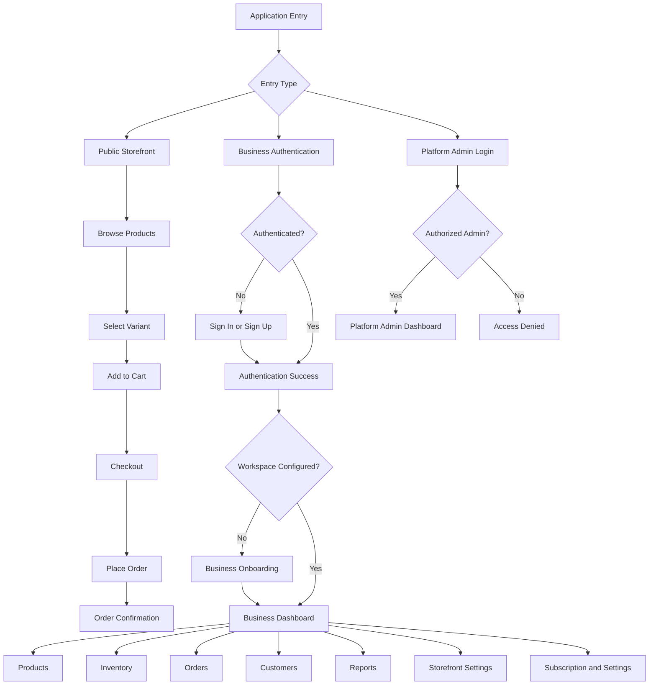
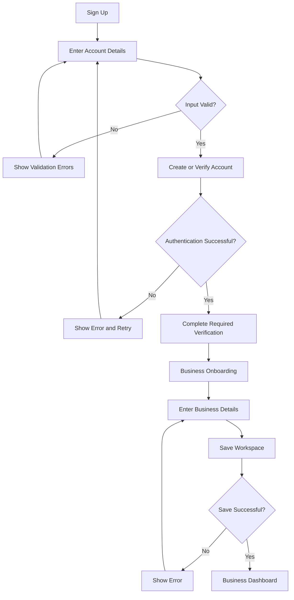
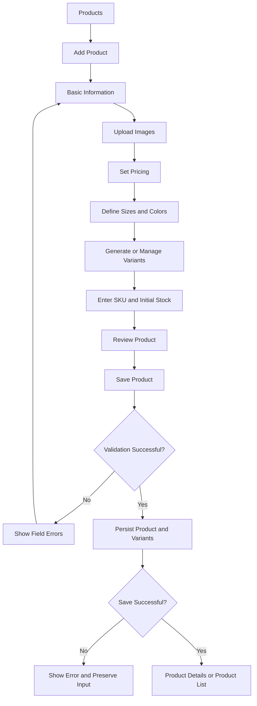
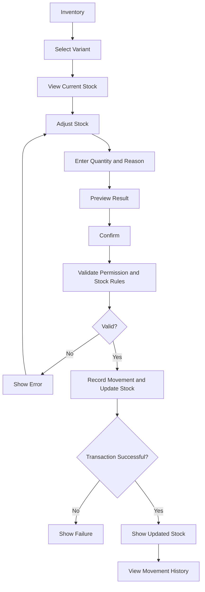
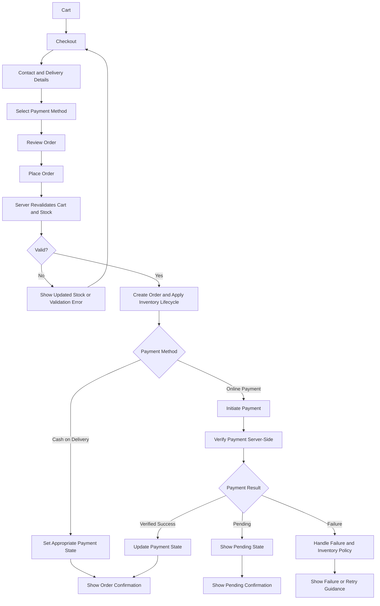
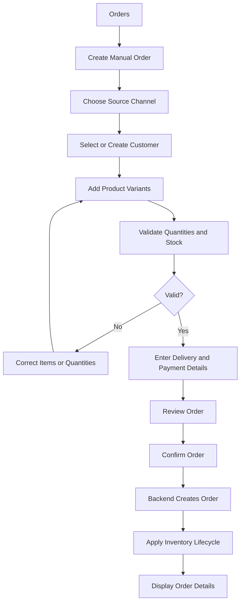
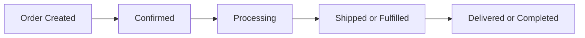
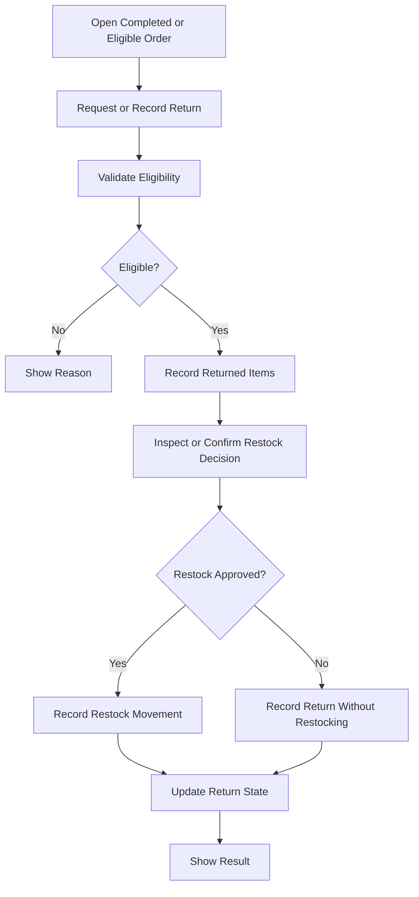
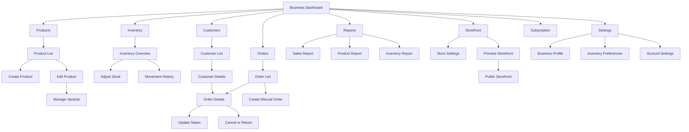

# App Flow — Clothing Brand SaaS

**Document:** AppFlow.md  
**Product:** Apparel-focused E-commerce, Billing & Inventory SaaS  
**Version:** 1.0  
**Status:** Draft  
**Last Updated:** 14 October 2026

---

## 1. Purpose

This document defines the application's navigation structure, user journeys, screen transitions, and major business workflows.

The application combines:

- Apparel product and variant management.
- Inventory management.
- Online storefront and checkout.
- Order and customer management.
- Manual Instagram and WhatsApp order entry.
- Sales analytics and reporting.
- SaaS subscriptions and administration.

The goal is to provide a clear and consistent experience for business owners, their authorized team members, customers, and platform administrators.

---

## 2. User Roles

### 2.1 Visitor

An unauthenticated person who visits a public storefront or authentication page.

### 2.2 Business Owner

The owner of a clothing brand, boutique, or social-commerce business.

**Permissions:**
- Manage the business workspace.
- Create and manage products.
- Manage inventory.
- View and manage orders.
- Manage customers and discounts.
- Configure the storefront.
- View reports.
- Manage subscription settings.

### 2.3 Business Team Member

An authorized user who accesses a business workspace.

Permissions depend on the roles and access-control features implemented. The MVP must not imply that detailed role customization exists unless it has been implemented.

### 2.4 Storefront Customer

A person browsing a public store, adding products to a cart, and placing an order.

### 2.5 Platform Administrator

An authorized operator responsible for SaaS-level administration, plans, subscriptions, and platform operations.

Platform administration must be separated from normal business access.

---

## 3. Application Entry Points

The application has four main entry points.

1. **Public Storefront**
   - A customer visits a business's storefront.
   - The customer browses products and places an order.

2. **Business Authentication**
   - A business owner signs in or creates an account.
   - The user enters the business management workspace.

3. **Business Workspace**
   - An authenticated user manages products, stock, orders, customers, reports, and settings.

4. **Platform Administration**
   - An authorized platform administrator enters a protected administration area.

Each entry point must enforce the appropriate access rules.

---

## 4. High-Level Application Flow



---

## 5. Public Routes and Protected Routes

The exact route structure may change during implementation, but the application should follow this separation.

### 5.1 Public Routes

| Route Concept | Purpose |
|---|---|
| `/` | Marketing or product landing page, if included |
| `/login` | Business sign-in |
| `/signup` | Business registration |
| `/forgot-password` | Password recovery |
| `/reset-password` | Password reset |
| `/store/[storeSlug]` | Public storefront |
| `/store/[storeSlug]/products/[productSlug]` | Product details |
| `/store/[storeSlug]/collections/[collectionSlug]` | Collection page |
| `/store/[storeSlug]/cart` | Shopping cart |
| `/store/[storeSlug]/checkout` | Checkout |
| `/store/[storeSlug]/order-confirmation/[orderReference]` | Order confirmation |

**Note:** Route names are conceptual examples, not approved final URLs. Sensitive order information must not be exposed through a guessable reference alone.

### 5.2 Protected Business Routes

| Route Concept | Purpose |
|---|---|
| `/app` | Dashboard redirect or workspace overview |
| `/app/onboarding` | Initial business setup |
| `/app/products` | Product catalogue |
| `/app/products/new` | Create product |
| `/app/products/[productId]` | View or edit product |
| `/app/collections` | Collections management |
| `/app/categories` | Categories management |
| `/app/inventory` | Inventory overview |
| `/app/inventory/movements` | Stock movement history |
| `/app/orders` | Order list |
| `/app/orders/new` | Create a manual order |
| `/app/orders/[orderId]` | Order details |
| `/app/customers` | Customer list |
| `/app/customers/[customerId]` | Customer details |
| `/app/discounts` | Discounts |
| `/app/reports` | Reports and analytics |
| `/app/storefront` | Storefront configuration |
| `/app/settings` | Business settings |
| `/app/subscription` | SaaS plan and subscription |

The authenticated user's workspace context must be established and authorized before tenant-specific data is accessed.

### 5.3 Platform Administration Routes

| Route Concept | Purpose |
|---|---|
| `/admin` | Platform overview |
| `/admin/businesses` | Registered businesses |
| `/admin/plans` | Subscription plan management |
| `/admin/subscriptions` | Subscription overview |
| `/admin/operations` | Operational monitoring, where implemented |

All platform administration routes require explicit server-side authorization.

---

## 6. Flow 1 — Business Registration and Onboarding

### Objective

Help a new business owner create an account and prepare the workspace.

### User Flow

1. User opens the application.
2. User selects **Sign Up**.
3. User enters the required registration details.
4. Application validates the input.
5. Authentication service creates or verifies the account.
6. User completes any required email verification.
7. Application establishes an authenticated session.
8. User enters onboarding.
9. User provides the business or brand name.
10. User selects the business type.
11. User enters any required business details.
12. User configures basic storefront preferences, if included.
13. Application saves the workspace configuration.
14. User reaches the business dashboard.

### Flow Diagram



### Business Rules

- A workspace must have an authenticated owner or an equivalent authorized owner record.
- A user's workspace access must be explicitly established.
- Onboarding data must be saved securely.
- Repeated requests must not create duplicate workspaces unintentionally.
- Users who leave onboarding should be able to resume it where supported.
- The application must not rely solely on client-side checks to authorize workspace creation.

---

## 7. Flow 2 — Returning User Sign-In

### Objective

Allow an existing user to securely access the correct workspace.

### User Flow

1. User opens the sign-in page.
2. User enters authentication credentials.
3. Application validates the input.
4. Authentication service verifies the credentials.
5. Application establishes the session.
6. Application checks the user's authorized workspace memberships.
7. If onboarding is incomplete, the user continues onboarding.
8. If the user has one accessible workspace, open that workspace.
9. If the user has multiple accessible workspaces, show a workspace selector.
10. Load the authorized dashboard.

### Failure Cases

- Invalid credentials.
- Unverified account, where verification is required.
- Expired session.
- Disabled or restricted account.
- No accessible workspace.
- Workspace access revoked.

Each failure must produce a clear message and an appropriate next action.

---

## 8. Flow 3 — Dashboard Navigation

### Objective

Provide one central location for daily business operations.

### User Flow

1. User enters the dashboard.
2. Application loads authorized business metrics.
3. User reviews sales, orders, and inventory alerts.
4. User chooses a quick action or navigation item.
5. Application opens the selected screen.
6. User completes the relevant operation.
7. User returns to the dashboard or continues another workflow.

### Quick Actions

- Add Product.
- Adjust Stock.
- Create Order.
- View Orders.
- View Storefront.
- Open Reports.

### Rules

- Metrics must be scoped to the active tenant.
- Loading and error states must be visible.
- Dashboard values must reflect the defined metric calculations.
- Empty dashboards must provide helpful next steps.
- Quick actions must navigate to real implemented workflows.

---

## 9. Flow 4 — Product Creation and Variant Management

### Objective

Allow a business owner to create an apparel product with size and color variants.

### User Flow

1. User opens Products.
2. User selects **Add Product**.
3. User enters the product name and description.
4. User selects a category or collection.
5. User uploads product images.
6. User enters pricing details.
7. User defines applicable sizes and colors.
8. Application creates or displays the required variants.
9. User reviews each variant.
10. User enters a SKU and initial stock quantity for each variant.
11. User selects a product status.
12. User saves the product.
13. Application validates the data.
14. Backend saves the product, variants, and required inventory records.
15. Application confirms success and opens the product details or product list.

### Flow Diagram



### Business Rules

- Product and variant records must belong to the correct tenant.
- SKU uniqueness should be enforced within the relevant tenant scope.
- Stock must be recorded against the correct variant.
- Invalid prices or quantities must be rejected.
- Product creation must not leave inconsistent partial records.
- Public visibility depends on publication status and storefront rules.
- Historical order items must preserve the values relevant to the time of purchase.

---

## 10. Flow 5 — Product Editing

### User Flow

1. User opens Products.
2. User selects a product.
3. Application loads the product and its variants.
4. User changes product information, pricing, images, or variants.
5. User reviews the changes.
6. User saves.
7. Backend validates and persists the changes.
8. Application displays the updated product.

### Special Cases

- If a variant is already present in an order, historical order details must remain unchanged.
- Removing or deactivating a variant must not silently delete historical records.
- SKU changes must respect uniqueness rules.
- Stock changes must follow the inventory adjustment workflow.
- If a save fails, the user should not lose their unsaved form data unnecessarily.

---

## 11. Flow 6 — Inventory Adjustment

### Objective

Keep inventory accurate and auditable.

### User Flow

1. User opens Inventory.
2. User searches for a product or SKU.
3. User selects a variant.
4. Application displays current stock.
5. User selects **Adjust Stock**.
6. User enters a quantity change or a corrected quantity.
7. User selects or enters a reason.
8. Application previews the resulting quantity.
9. User confirms the adjustment.
10. Backend verifies permission and validates the operation.
11. Backend records the stock movement and updates the authoritative inventory state.
12. Application confirms success.
13. User can open the movement history.

### Flow Diagram



### Business Rules

- Inventory operations must be tenant-scoped and authorized.
- Every stock adjustment must have an auditable movement record.
- Stock updates must be atomic.
- Duplicate submissions must not apply the same adjustment twice.
- Negative stock must be rejected unless a separately approved policy explicitly permits it.
- Inventory changes caused by orders must use the same authoritative inventory service.
- The displayed result must reflect the confirmed backend outcome.

---

## 12. Flow 7 — Public Storefront Browsing

### Objective

Help customers discover clothing products and choose the correct variants.

### User Flow

1. Customer opens a storefront URL.
2. Application loads the published store and products.
3. Customer browses the home page or a collection.
4. Customer opens a product.
5. Application displays images, description, price, sizes, colors, and availability.
6. Customer selects a valid variant.
7. Customer selects a quantity.
8. Customer adds the item to the cart.
9. Application confirms the action.
10. Customer continues browsing or opens the cart.

### Rules

- Only eligible published products should appear.
- Variant availability must be checked against current inventory rules.
- Invalid or unavailable variants must not be silently selected.
- The interface must communicate unavailable sizes or colors.
- Product pricing shown to customers must be validated again during checkout.

---

## 13. Flow 8 — Cart Management

### Objective

Allow customers to review and update selected products before checkout.

### User Flow

1. Customer opens the cart.
2. Application displays cart line items.
3. Customer reviews product, variant, quantity, and price.
4. Customer updates a quantity or removes an item.
5. Application recalculates the displayed totals.
6. Customer proceeds to checkout.

### Validation

- Quantities must be positive valid integers.
- Unavailable variants must be identified.
- Stock must be revalidated during checkout.
- Client-side cart values must not be trusted as the final order price.
- The backend must calculate the authoritative total.

### Cart Persistence

Cart persistence may use an appropriate client-side or server-side strategy, depending on the approved architecture.

The interface must handle expired sessions, cleared local data, or unavailable products gracefully.

---

## 14. Flow 9 — Checkout and Online Order Creation

### Objective

Convert a valid cart into a confirmed order.

### User Flow

1. Customer selects Checkout.
2. Application validates the cart.
3. Customer enters contact and delivery information.
4. Application displays available payment methods.
5. Customer selects a supported payment method.
6. Application displays the final order summary.
7. Customer selects **Place Order**.
8. Backend revalidates products, variants, prices, discounts, and stock.
9. Backend creates the order and handles inventory reservation or deduction according to the approved lifecycle.
10. If online payment is selected, the payment flow begins.
11. The backend verifies the payment result.
12. The order and payment states are updated appropriately.
13. Customer sees the appropriate confirmation or pending/failure state.

### Flow Diagram



### Business Rules

- Order creation must be protected against duplicate submissions.
- Server-side prices and discount rules are authoritative.
- Payment success must be verified server-side.
- A browser redirect alone must not mark an order as paid.
- Inventory reservation, deduction, release, and restocking must follow one defined lifecycle.
- Failed payments must not leave inventory permanently reserved without a recovery or expiry policy.
- The exact stock reservation and payment sequencing must be finalized during technical design.
- Order items must preserve product names, variant information, prices, and quantities at purchase time.
- Order status and payment status must remain separate.

---

## 15. Flow 10 — Cash on Delivery

### Objective

Allow a customer to place an order using COD when enabled by the business.

### User Flow

1. Customer completes checkout details.
2. Customer selects Cash on Delivery.
3. Backend validates the order.
4. Backend creates the order.
5. Payment status is recorded as unpaid or pending according to the approved state model.
6. Order status is set to the appropriate initial state.
7. Inventory follows the approved reservation or deduction policy.
8. Customer receives an order confirmation.
9. Business owner processes the order.
10. Payment status is updated when payment is collected and recorded.

### Rules

- COD availability must be configurable according to supported business rules.
- COD must not be represented as an online payment success.
- Order confirmation must clearly identify the payment method.
- Cancellation and return flows must apply the same inventory rules as other orders.

---

## 16. Flow 11 — Manual Instagram and WhatsApp Orders

### Objective

Allow business owners to manage social-commerce orders alongside website orders.

### User Flow

1. Owner opens Orders.
2. Owner selects **Create Order**.
3. Owner chooses Instagram, WhatsApp, or another supported manual source.
4. Owner selects an existing customer or enters customer details.
5. Owner adds product variants and quantities.
6. Application validates stock availability.
7. Owner enters delivery information if required.
8. Owner selects the payment method and records the applicable payment state.
9. Owner reviews the total.
10. Owner confirms the order.
11. Backend creates the order and applies the inventory lifecycle.
12. Application displays the order details.

### Flow Diagram



### Business Rules

- Social orders must use the same order and inventory services as website orders.
- Source-channel attribution must be saved with the order.
- Stock must not be decremented twice.
- Payment status must accurately reflect what the owner records or what the payment provider verifies.
- Manual order creation must be permission-controlled.
- The MVP records orders manually; it does not automatically import Instagram DMs or WhatsApp conversations.

---

## 17. Flow 12 — Order Fulfillment and Status Updates

### Objective

Allow the business to process orders from creation through completion.

### Conceptual Lifecycle



This is a conceptual lifecycle. The final state machine must account for the selected payment methods, fulfillment approach, cancellation rules, and supported order types.

### User Flow

1. Owner opens Orders.
2. Owner selects an order.
3. Application displays the current state.
4. Owner selects a valid next action.
5. Application validates the transition.
6. Backend updates the order state.
7. Backend records the status history.
8. Application displays the confirmed new state.

### Rules

- Only valid transitions are permitted.
- Status changes must be authorized.
- State changes must be auditable.
- Repeated requests must not create duplicate side effects.
- Payment and fulfillment states remain independent.
- The system must not claim that a parcel was delivered unless the relevant process confirms it.

---

## 18. Flow 13 — Order Cancellation

### Objective

Cancel an eligible order while preserving inventory and payment consistency.

### User Flow

1. Owner opens the order details.
2. Owner selects Cancel Order.
3. Application explains the consequences.
4. Owner confirms cancellation.
5. Backend checks the current state and cancellation eligibility.
6. Backend performs the required order-state update.
7. Backend releases or restores inventory according to the inventory lifecycle.
8. If payment was collected, the applicable refund process is initiated or presented for manual handling.
9. Application displays the confirmed outcome.

### Rules

- Cancellation must be idempotent.
- Inventory must not be released or restocked twice.
- Refund status must not be marked successful until verified.
- Completed fulfillment may require a return workflow rather than ordinary cancellation.
- The exact cancellation policy must be finalized before implementation.

---

## 19. Flow 14 — Returns and Restocking

### Objective

Support basic returns and inventory correction where included in the MVP.

### Conceptual Flow



### Rules

- Return quantities must not exceed eligible quantities.
- Restocking requires a corresponding inventory movement.
- Returned stock must not be made available automatically if the business has not approved it for resale.
- Refund and return states must be tracked accurately.
- Advanced exchange and return logistics remain outside the initial MVP unless separately approved.

---

## 20. Flow 15 — Customer Management

### User Flow

1. Owner opens Customers.
2. Owner searches for a customer or creates a new one.
3. Owner views or edits permitted customer information.
4. Owner opens the customer's order history.
5. Owner selects an order to inspect its details.

### Rules

- Customer records must be tenant-scoped.
- Customer contact information must be protected.
- Duplicate-customer handling should be defined using appropriate identifiers.
- Order history must use the correct customer and tenant relationships.
- Deleting or anonymizing customer information must respect order retention and applicable legal requirements.

---

## 21. Flow 16 — Discounts

### User Flow

1. Owner opens Discounts.
2. Owner selects Create Discount.
3. Owner enters the code and discount configuration.
4. Application validates the configuration.
5. Owner saves the discount.
6. Backend stores the discount.
7. Application confirms success.
8. During checkout, backend validates the code, eligibility, dates, and applicable limits.
9. The discount is applied to the authoritative order calculation if valid.

### Rules

- Discount rules must be enforced server-side.
- Invalid, expired, or ineligible discounts must be rejected.
- Discount calculations must use consistent rounding rules.
- The order must preserve the discount applied at purchase time.
- Usage limits must be updated safely under concurrent requests if implemented.

---

## 22. Flow 17 — Reports and Analytics

### User Flow

1. Owner opens Reports.
2. Application loads authorized business data.
3. Owner selects a date range.
4. Application updates the relevant metrics and charts.
5. Owner reviews product, sales, order, or channel performance.
6. Owner exports CSV if the selected report supports export.

### Rules

- All data must be tenant-scoped.
- Metric definitions must be consistent across dashboard and reports.
- The application must distinguish gross sales, discounts, refunds, net sales, and payment collections where those metrics are shown.
- Empty reports must explain why no data is available.
- CSV exports must respect the user's permissions and current tenant scope.

---

## 23. Flow 18 — Storefront Configuration

### User Flow

1. Owner opens Storefront.
2. Application loads the current storefront configuration.
3. Owner edits available settings such as store name, logo, colors, or product visibility.
4. Owner previews the storefront when supported.
5. Owner saves the changes.
6. Backend validates and persists the settings.
7. Owner opens or copies the public storefront URL.
8. Customer-facing pages display the published configuration.

### Rules

- Storefront settings must be tenant-scoped.
- Invalid configuration must not break the public storefront.
- Only eligible products should be published.
- Preview and publication states must be clearly distinguished where supported.
- Custom domains are optional and are not a required MVP feature.

---

## 24. Flow 19 — Subscription and Plan Management

### Objective

Let business owners understand their current SaaS plan and available upgrades.

### User Flow

1. Owner opens Subscription.
2. Application loads the current plan and subscription status.
3. Owner reviews plan features and usage limits.
4. Owner selects an available plan or upgrade action.
5. Application displays applicable terms.
6. If a billing provider is configured, the subscription operation proceeds through the supported provider flow.
7. Backend verifies and records the subscription state.
8. Application displays the confirmed result.

### Business Model

The intended monetization model includes:

- Free plan.
- Trial of premium features.
- Multiple paid tiers based on business size or advanced capabilities.

Exact prices, plan limits, trial duration, billing provider, and upgrade/downgrade policies remain undecided.

### Rules

- The frontend must not be the source of truth for subscription entitlement.
- Restricted features must be enforced by backend authorization or entitlement checks.
- Subscription state must be verified before updating account access.
- Failed billing attempts must be handled without incorrectly granting paid entitlements.
- Trial expiration and downgrade behavior must be defined before implementation.

---

## 25. Flow 20 — Platform Administration

### Objective

Allow authorized platform administrators to manage the SaaS platform.

### User Flow

1. Administrator opens the protected admin area.
2. Backend verifies the administrator's role and permissions.
3. Application loads the platform overview.
4. Administrator selects a management section.
5. Application displays authorized platform-level data.
6. Administrator performs an allowed action.
7. Backend validates the action.
8. Important changes are recorded in an audit log.
9. Application displays the confirmed result.

### Rules

- Admin authorization must be enforced server-side.
- Ordinary business users must not access platform administration.
- Tenant-specific records must not be exposed unnecessarily.
- Administrative changes must be auditable.
- High-impact actions should require confirmation.
- Administrative interfaces must not provide unrestricted access to sensitive information by default.

---

## 26. Flow 21 — Workspace Switching

This flow applies when a user can access multiple business workspaces.

### User Flow

1. User opens the workspace switcher.
2. Application displays authorized workspaces.
3. User selects a workspace.
4. Backend or application session establishes the correct workspace context.
5. Application reloads tenant-specific data.
6. User continues in the selected workspace.

### Rules

- The user must be authorized for the selected workspace.
- Workspace changes must not mix cached data from different tenants.
- All subsequent requests must use the correct tenant context.
- The active workspace should remain visually identifiable.
- If the user has access to only one workspace, a switcher is unnecessary.

---

## 27. Cross-Cutting Error Flows

Every major workflow must support consistent error handling.

### 27.1 Validation Error

```text
User submits a form
    ↓
Application validates input
    ↓
Invalid data?
    ├── Yes → Display field-level errors
    │         Preserve entered values
    │         Allow correction
    └── No  → Continue request
```

### 27.2 Network or Server Error

```text
User performs an action
    ↓
Request is sent
    ↓
Server or network error?
    ├── Yes → Display understandable error
    │         Preserve context
    │         Offer retry where safe
    └── No  → Display confirmed result
```

### 27.3 Session Expiration

```text
Protected request
    ↓
Session valid?
    ├── Yes → Continue
    └── No  → Request sign-in
              Restore intended destination where safe
              Re-check authorization after sign-in
```

### 27.4 Unknown Operation Outcome

If a request times out after the server may have processed it:

- Do not automatically repeat a non-idempotent operation.
- Check the operation's final state where possible.
- Use idempotency keys for supported high-impact operations.
- Clearly communicate whether the outcome is pending or confirmed.

This is especially important for order creation, payment handling, stock adjustment, and refunds.

---

## 28. Global Business Rules

The following rules apply across the application.

### 28.1 Tenant Isolation

- Every business-owned record must be associated with the appropriate tenant.
- Backend authorization must validate access to the tenant.
- Database-level protections should be used where supported by the approved architecture.
- Tenant isolation must be tested.

### 28.2 Inventory Consistency

- Inventory is managed at the product-variant level.
- All stock-changing workflows must use the same authoritative inventory service.
- Stock movements must be auditable.
- Concurrent updates must not cause overselling or lost stock changes.
- Reservation, deduction, release, and restocking rules must be explicitly defined.

### 28.3 Order Consistency

- Orders must preserve historical item details and pricing.
- Order and payment statuses are separate.
- Status transitions must be validated.
- Order creation must prevent unintended duplicates.
- Website and manual social orders must follow consistent business rules.

### 28.4 Security

- Protected pages require authentication.
- Sensitive actions require server-side authorization.
- Payment provider secrets must remain server-side.
- Customer information must be appropriately protected.
- Admin operations must be restricted and auditable.

### 28.5 Subscription Entitlements

- The backend determines which features a business can access.
- Client-side feature hiding is not sufficient for enforcement.
- Plan changes must be reflected only after the authoritative subscription state is updated.

---

## 29. Navigation Map



---

## 30. MVP Implementation Order

The application flows should be implemented in dependency order.

### Phase 1 — Foundation

- Application shell.
- Authentication.
- Workspace creation.
- Tenant authorization.
- Onboarding.

### Phase 2 — Catalogue

- Product list.
- Product creation and editing.
- Product images.
- Categories and collections.
- Apparel variants and SKUs.

### Phase 3 — Inventory

- Variant-level inventory.
- Stock adjustments.
- Inventory ledger.
- Low-stock alerts.
- Concurrency and stock validation.

### Phase 4 — Storefront

- Public storefront.
- Product listing and details.
- Variant selection.
- Cart.
- Checkout validation.

### Phase 5 — Orders and Payments

- Order creation.
- Order details and history.
- Configured payment methods.
- Server-side payment verification.
- Cancellation and basic return/restocking flows.

### Phase 6 — Business Operations

- Customer management.
- Manual social orders.
- Discounts.
- Sales and inventory reports.
- CSV export.

### Phase 7 — SaaS Administration

- Subscription and entitlement management.
- Plan administration.
- Platform administration.
- Audit logging and operational monitoring.

### Phase 8 — Production Readiness

- Automated tests.
- Tenant isolation tests.
- Payment and inventory consistency tests.
- Responsive and accessibility testing.
- Security review.
- Backup and recovery verification.
- Deployment and monitoring validation.

---

## 31. Acceptance Criteria

The application flow is ready for implementation when:

- [ ] All major user roles and entry points are defined.
- [ ] Authentication and onboarding flows are clear.
- [ ] Business workspace access is explicitly controlled.
- [ ] Product creation includes apparel variants.
- [ ] Inventory changes have defined validation and audit behavior.
- [ ] Storefront browsing and cart flows are defined.
- [ ] Checkout and payment states are clearly separated.
- [ ] Manual Instagram and WhatsApp order flows are defined.
- [ ] Order lifecycle and cancellation behavior are documented.
- [ ] Customer and discount workflows are defined.
- [ ] Reports and exports respect tenant permissions.
- [ ] Subscription entitlements are enforced server-side.
- [ ] Error, loading, empty, and pending states are accounted for.
- [ ] Important workflows are idempotent or protected against duplicate side effects.
- [ ] Open business rules are resolved before their corresponding implementation begins.

---

## 32. Open Decisions

The following items require confirmation or technical definition before the affected features are implemented:

- Final approved technology stack.
- Authentication and email verification configuration.
- Supported online payment gateway.
- COD availability rules.
- Inventory reservation and deduction lifecycle.
- Payment failure and reservation-expiry policy.
- Order status state machine.
- Cancellation and refund policy.
- Return eligibility and restocking rules.
- Shipping and fulfillment approach.
- Storefront URL and slug strategy.
- SaaS billing provider.
- Subscription prices, trial duration, and plan limits.
- Detailed team roles and permissions.
- Data retention and deletion policy.

Do not silently make a product or technology decision that materially changes the approved scope.

---

## 33. Final Definition

The application must provide a coherent end-to-end experience for clothing businesses:

**Create a business → Add products and variants → Track inventory → Publish a storefront → Receive orders → Manage payments and fulfillment → Manage customers → Review performance → Grow through SaaS subscription tiers.**

All major workflows must remain consistent, tenant-safe, auditable, and aligned with the approved PRD, TRD, and UI/UX Brief.

---

**End of Document**
