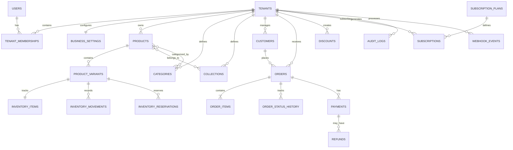

# Database Schema — Clothing Brand SaaS

**Document:** DB_Schema.md  
**Product:** Apparel-focused E-commerce, Billing & Inventory SaaS  
**Version:** 1.0  
**Status:** Draft — Pending Technical Review  
**Last Updated:** 14 October 2026

---

## 1. Purpose

This document defines the proposed relational database structure for the Clothing Brand SaaS platform.

The database must support:

- Multiple businesses on one SaaS platform.
- Secure tenant-level data isolation.
- Business users and workspace memberships.
- Clothing products, sizes, colors, and variants.
- SKU management.
- Inventory quantities and stock movement history.
- Product categories and collections.
- Public storefronts.
- Orders from websites and manually entered social channels.
- Customer records and addresses.
- Payments, refunds, and order status history.
- Discounts and promotions.
- SaaS plans, subscriptions, and feature entitlements.
- Audit logs and webhook processing.
- Reporting and operational monitoring.

The design prioritizes data integrity, tenant isolation, inventory consistency, and future extensibility.

---

## 2. Database Design Principles

### 2.1 Multi-Tenancy

The platform will serve multiple businesses.

Each business is represented by a tenant. Business-owned records must be associated with the correct tenant.

Rules:

- Tenant-owned data must include a `tenant_id` directly or through a clearly enforced parent relationship.
- Queries must be scoped to the active tenant.
- Tenant ownership must be validated server-side.
- Database-level access policies should be used where supported by the approved architecture.
- Cross-tenant access must be prohibited unless explicitly authorized for a legitimate platform-administration operation.

### 2.2 Relational Integrity

Use primary keys, foreign keys, unique constraints, check constraints, and appropriate indexes.

Important relationships must be enforced by the database rather than relying entirely on application code.

### 2.3 Historical Accuracy

Orders must preserve the values that applied at purchase time.

Order items should store snapshots of:

- Product name.
- Variant description.
- SKU.
- Unit price.
- Quantity.
- Discount allocation.
- Relevant tax amount, if tax calculation is supported.
- Final line total.

Changing or archiving a product must not rewrite historical order information.

### 2.4 Inventory Accuracy

Inventory must be tracked at the variant level.

Every stock-changing operation must be recorded in an inventory movement ledger. The current stock balance must remain consistent with the ledger and the approved reservation model.

### 2.5 Money Representation

Store monetary values using fixed-precision decimal types or integer minor units, according to the approved implementation convention.

Do not use floating-point types for financial calculations.

The examples below use `NUMERIC(12,2)` for readability. Currency and rounding policies must be finalized before implementation.

### 2.6 Timestamps

Store timestamps consistently, preferably as `TIMESTAMPTZ` in PostgreSQL.

Use UTC for storage and convert to the appropriate business or customer timezone for display.

### 2.7 Identifiers

Use UUID primary keys for most application entities.

Human-readable identifiers such as order numbers and SKUs should be separate fields rather than primary keys.

### 2.8 Technology Independence

This schema is a logical design. The final implementation may use PostgreSQL or another approved database technology.

No technology-stack change is authorized by this document.

---

## 3. Entity Relationship Overview



This is a conceptual relationship diagram. Exact cardinalities and optional relationships will be enforced in the implementation schema.

---

## 4. Core Entity List

| Entity | Purpose |
|---|---|
| `users` | Application user identity reference |
| `tenants` | Business workspaces |
| `tenant_memberships` | User access to business workspaces |
| `business_settings` | Business preferences |
| `products` | Product catalogue |
| `product_variants` | Size/color combinations and SKUs |
| `categories` | Product categorization |
| `collections` | Storefront product groupings |
| `product_collections` | Product-to-collection relationship |
| `product_categories` | Product-to-category relationship, if multiple categories are allowed |
| `product_images` | Product image metadata |
| `inventory_items` | Current stock balances |
| `inventory_movements` | Auditable stock changes |
| `inventory_reservations` | Stock held for pending orders, if reservations are implemented |
| `customers` | Business customer records |
| `customer_addresses` | Customer delivery addresses |
| `orders` | Order headers |
| `order_items` | Historical line-item snapshots |
| `order_status_history` | Order lifecycle events |
| `payments` | Payment attempts and payment states |
| `refunds` | Refund records |
| `discounts` | Discount configuration |
| `discount_redemptions` | Applied discount records, if required |
| `subscription_plans` | SaaS plan definitions |
| `subscriptions` | Tenant subscription records |
| `audit_logs` | Important business and administrative events |
| `webhook_events` | Idempotent processing of provider events |

---

## 5. Users and Tenants

### 5.1 `users`

Stores the application's user identity reference.

If a managed authentication provider is selected, authentication credentials should remain in that provider. The application may store a corresponding profile record.

| Column | Type | Constraints | Description |
|---|---|---|---|
| `id` | UUID | Primary key | User identifier |
| `display_name` | VARCHAR(150) | Nullable | User display name |
| `avatar_url` | TEXT | Nullable | Profile image URL |
| `created_at` | TIMESTAMPTZ | Required | Creation timestamp |
| `updated_at` | TIMESTAMPTZ | Required | Last update timestamp |

Authentication email and identity fields should follow the approved authentication provider's data model.

### 5.2 `tenants`

Represents a clothing business or brand workspace.

| Column | Type | Constraints | Description |
|---|---|---|---|
| `id` | UUID | Primary key | Tenant identifier |
| `name` | VARCHAR(200) | Required | Business or brand name |
| `slug` | VARCHAR(100) | Required | Unique public identifier |
| `business_type` | VARCHAR(50) | Required | Brand, boutique, or social seller |
| `status` | VARCHAR(30) | Required | Workspace status |
| `created_at` | TIMESTAMPTZ | Required | Creation timestamp |
| `updated_at` | TIMESTAMPTZ | Required | Last update timestamp |

Suggested `status` values:

- `active`
- `suspended`
- `pending_setup`
- `closed`

Rules:

- `slug` must be unique within the chosen namespace.
- Workspace suspension must not silently delete business data.
- Public storefront visibility must respect workspace status.
- Workspace creation must establish an authorized owner membership.

### 5.3 `tenant_memberships`

Links users to workspaces.

| Column | Type | Constraints | Description |
|---|---|---|---|
| `id` | UUID | Primary key | Membership identifier |
| `tenant_id` | UUID | Foreign key to `tenants.id` | Workspace |
| `user_id` | UUID | Foreign key to `users.id` | User |
| `role` | VARCHAR(30) | Required | Workspace role |
| `status` | VARCHAR(30) | Required | Membership status |
| `created_at` | TIMESTAMPTZ | Required | Creation timestamp |

Suggested roles:

- `owner`
- `admin`
- `manager`
- `staff`

Suggested statuses:

- `active`
- `invited`
- `suspended`
- `removed`

Constraints:

- Unique membership for each `(tenant_id, user_id)` pair.
- Role permissions must be enforced server-side.
- Ownership transfer and removal of the last owner require explicit business rules.

Detailed role-based permissions may be implemented later.

### 5.4 `business_settings`

Stores tenant-level configuration.

| Column | Type | Constraints | Description |
|---|---|---|---|
| `id` | UUID | Primary key | Settings identifier |
| `tenant_id` | UUID | Unique foreign key | Workspace |
| `currency_code` | CHAR(3) | Required | Business currency |
| `timezone` | VARCHAR(100) | Required | Business timezone |
| `support_email` | VARCHAR(255) | Nullable | Customer support email |
| `support_phone` | VARCHAR(30) | Nullable | Customer support phone |
| `logo_url` | TEXT | Nullable | Business logo |
| `brand_settings` | JSONB | Nullable | Approved visual settings |
| `created_at` | TIMESTAMPTZ | Required | Creation timestamp |
| `updated_at` | TIMESTAMPTZ | Required | Last update timestamp |

Currency changes must not alter historical order currency or totals.

---

## 6. Product Catalogue

### 6.1 `products`

Represents a product such as a T-shirt, kurta, dress, hoodie, or pair of trousers.

| Column | Type | Constraints | Description |
|---|---|---|---|
| `id` | UUID | Primary key | Product identifier |
| `tenant_id` | UUID | Foreign key | Owning workspace |
| `name` | VARCHAR(250) | Required | Product name |
| `slug` | VARCHAR(250) | Required | Storefront slug |
| `description` | TEXT | Nullable | Product description |
| `status` | VARCHAR(30) | Required | Product publication status |
| `seo_title` | VARCHAR(250) | Nullable | Search title |
| `seo_description` | TEXT | Nullable | Search description |
| `created_by` | UUID | Nullable foreign key | Creating user |
| `created_at` | TIMESTAMPTZ | Required | Creation timestamp |
| `updated_at` | TIMESTAMPTZ | Required | Last update timestamp |
| `archived_at` | TIMESTAMPTZ | Nullable | Archive timestamp |

Suggested statuses:

- `draft`
- `active`
- `archived`

Constraints and rules:

- Product slug uniqueness should be enforced within the tenant.
- Archived products must remain available to historical orders.
- A product should not be publicly purchasable unless it is eligible for publication.
- Prices that vary by variant belong to the variant record.

### 6.2 `product_variants`

Each row represents one sellable combination of product attributes.

Example:

Product: Classic T-Shirt

- Black / S
- Black / M
- Black / L
- White / S
- White / M
- White / L

Each combination receives its own SKU and stock balance.

| Column | Type | Constraints | Description |
|---|---|---|---|
| `id` | UUID | Primary key | Variant identifier |
| `tenant_id` | UUID | Foreign key | Owning workspace |
| `product_id` | UUID | Foreign key | Parent product |
| `sku` | VARCHAR(100) | Required | Stock keeping unit |
| `barcode` | VARCHAR(100) | Nullable | Optional barcode |
| `size` | VARCHAR(50) | Nullable | Size label |
| `color` | VARCHAR(80) | Nullable | Color label |
| `attributes` | JSONB | Nullable | Additional variant attributes |
| `price` | NUMERIC(12,2) | Required | Selling price |
| `compare_at_price` | NUMERIC(12,2) | Nullable | Reference price |
| `cost_price` | NUMERIC(12,2) | Nullable | Optional internal cost |
| `status` | VARCHAR(30) | Required | Variant status |
| `created_at` | TIMESTAMPTZ | Required | Creation timestamp |
| `updated_at` | TIMESTAMPTZ | Required | Last update timestamp |

Rules:

- SKU must be unique within a tenant.
- Prices must be non-negative unless a separately approved rule allows otherwise.
- `compare_at_price`, when present, should follow the approved pricing rules.
- Size and color are optional for products that do not use those attributes.
- A variant must belong to the same tenant as its parent product.
- Variant attributes should use a consistent schema rather than arbitrary, inconsistent keys.
- Historical order items must not depend on the current variant price.

### 6.3 `categories`

Represents product categories.

| Column | Type | Constraints | Description |
|---|---|---|---|
| `id` | UUID | Primary key | Category identifier |
| `tenant_id` | UUID | Foreign key | Owning workspace |
| `name` | VARCHAR(150) | Required | Category name |
| `slug` | VARCHAR(180) | Required | Category slug |
| `description` | TEXT | Nullable | Description |
| `created_at` | TIMESTAMPTZ | Required | Creation timestamp |
| `updated_at` | TIMESTAMPTZ | Required | Last update timestamp |

Examples:

- T-Shirts
- Shirts
- Dresses
- Trousers
- Ethnic Wear

Category slug uniqueness should be enforced within the tenant.

### 6.4 `product_categories`

Use this join table if products can belong to multiple categories.

| Column | Type | Constraints |
|---|---|---|
| `product_id` | UUID | Foreign key |
| `category_id` | UUID | Foreign key |
| `tenant_id` | UUID | Foreign key |

Primary key:

`(product_id, category_id)`

If the product model allows exactly one category per product, use a single `category_id` on `products` instead. Choose one design before implementation.

### 6.5 `collections`

Represents a curated product grouping displayed on the storefront.

| Column | Type | Constraints | Description |
|---|---|---|---|
| `id` | UUID | Primary key | Collection identifier |
| `tenant_id` | UUID | Foreign key | Owning workspace |
| `name` | VARCHAR(180) | Required | Collection name |
| `slug` | VARCHAR(200) | Required | Collection slug |
| `description` | TEXT | Nullable | Collection description |
| `image_url` | TEXT | Nullable | Collection image |
| `status` | VARCHAR(30) | Required | Publication status |
| `created_at` | TIMESTAMPTZ | Required | Creation timestamp |
| `updated_at` | TIMESTAMPTZ | Required | Last update timestamp |

Examples:

- Summer Collection
- New Arrivals
- Festive Wear
- Best Sellers

### 6.6 `product_collections`

Links products to collections.

| Column | Type | Constraints |
|---|---|---|
| `product_id` | UUID | Foreign key |
| `collection_id` | UUID | Foreign key |
| `tenant_id` | UUID | Foreign key |
| `sort_order` | INTEGER | Optional ordering value |

Primary key:

`(product_id, collection_id)`

All related records must belong to the same tenant.

### 6.7 `product_images`

Stores image metadata. Actual image files should be stored in the selected object-storage service.

| Column | Type | Constraints | Description |
|---|---|---|---|
| `id` | UUID | Primary key | Image identifier |
| `tenant_id` | UUID | Foreign key | Owning workspace |
| `product_id` | UUID | Foreign key | Parent product |
| `variant_id` | UUID | Nullable foreign key | Optional variant association |
| `storage_path` | TEXT | Required | Storage object path |
| `alt_text` | VARCHAR(250) | Nullable | Accessible image description |
| `sort_order` | INTEGER | Required | Display order |
| `created_at` | TIMESTAMPTZ | Required | Creation timestamp |

Rules:

- Prefer storage paths over permanently storing expiring signed URLs.
- Generate public or signed URLs according to the storage and storefront access model.
- Validate file type, size, and authorization.
- Prevent one tenant from overwriting another tenant's images.
- Use an explicit ordering rule for product galleries.

---

## 7. Inventory Management

### 7.1 `inventory_items`

Stores the current inventory balance for a variant.

| Column | Type | Constraints | Description |
|---|---|---|---|
| `id` | UUID | Primary key | Inventory record |
| `tenant_id` | UUID | Foreign key | Owning workspace |
| `variant_id` | UUID | Unique foreign key within tenant | Product variant |
| `quantity_on_hand` | INTEGER | Required | Physical stock balance |
| `quantity_reserved` | INTEGER | Required | Stock reserved for orders |
| `low_stock_threshold` | INTEGER | Required | Alert threshold |
| `updated_at` | TIMESTAMPTZ | Required | Last update timestamp |

Suggested calculation:

`quantity_available = quantity_on_hand - quantity_reserved`

This is a derived value and does not need to be stored unless a separately validated optimization is required.

Constraints:

- Quantities must be non-negative unless an explicit alternative policy is approved.
- Reserved quantity must not exceed on-hand quantity under the standard model.
- One inventory balance must exist per sellable variant.
- Every inventory row must belong to the same tenant as its variant.

The final model must define whether `quantity_on_hand` includes stock that has been reserved but not yet shipped. All order workflows must use the same definition.

### 7.2 `inventory_movements`

An append-oriented ledger of stock changes.

| Column | Type | Constraints | Description |
|---|---|---|---|
| `id` | UUID | Primary key | Movement identifier |
| `tenant_id` | UUID | Foreign key | Owning workspace |
| `variant_id` | UUID | Foreign key | Affected variant |
| `movement_type` | VARCHAR(40) | Required | Type of stock movement |
| `quantity_delta` | INTEGER | Required | Signed quantity change |
| `quantity_before` | INTEGER | Required | Previous balance |
| `quantity_after` | INTEGER | Required | Resulting balance |
| `reference_type` | VARCHAR(40) | Nullable | Related operation type |
| `reference_id` | UUID | Nullable | Related entity identifier |
| `reason` | TEXT | Nullable | Explanation |
| `created_by` | UUID | Nullable foreign key | Actor |
| `idempotency_key` | VARCHAR(200) | Nullable | Duplicate-operation protection |
| `created_at` | TIMESTAMPTZ | Required | Event timestamp |

Suggested movement types:

- `opening_stock`
- `manual_adjustment`
- `order_reservation`
- `reservation_release`
- `order_deduction`
- `cancellation_restock`
- `return_restock`
- `damage_write_off`
- `correction`

Rules:

- Stock changes and ledger inserts must be transactionally consistent.
- Historical movements should not be silently edited or deleted.
- Corrections should use compensating movements.
- The meaning of `quantity_delta` must be consistent for each movement type.
- Reservation changes should be tracked distinctly from physical stock changes when using a reservation model.
- Idempotency keys must be scoped appropriately to prevent accidental duplicate processing.

### 7.3 `inventory_reservations`

Optional table if stock reservations are implemented.

| Column | Type | Constraints | Description |
|---|---|---|---|
| `id` | UUID | Primary key | Reservation identifier |
| `tenant_id` | UUID | Foreign key | Owning workspace |
| `variant_id` | UUID | Foreign key | Reserved variant |
| `order_id` | UUID | Foreign key | Related order |
| `quantity` | INTEGER | Required | Reserved quantity |
| `status` | VARCHAR(30) | Required | Reservation state |
| `expires_at` | TIMESTAMPTZ | Nullable | Expiry timestamp |
| `created_at` | TIMESTAMPTZ | Required | Creation timestamp |
| `released_at` | TIMESTAMPTZ | Nullable | Release timestamp |

Suggested statuses:

- `active`
- `released`
- `committed`
- `expired`

Rules:

- Reservation creation must be concurrency-safe.
- Reservations must not exceed available stock.
- A reservation must be released or committed at most once.
- Expired reservations require a reliable cleanup or recovery mechanism.
- This table is required only if the chosen order/payment flow uses explicit reservations.

---

## 8. Customers

### 8.1 `customers`

Represents a customer associated with a business.

| Column | Type | Constraints | Description |
|---|---|---|---|
| `id` | UUID | Primary key | Customer identifier |
| `tenant_id` | UUID | Foreign key | Owning workspace |
| `first_name` | VARCHAR(100) | Nullable | First name |
| `last_name` | VARCHAR(100) | Nullable | Last name |
| `email` | VARCHAR(255) | Nullable | Email address |
| `phone` | VARCHAR(30) | Nullable | Phone number |
| `notes` | TEXT | Nullable | Business notes |
| `created_at` | TIMESTAMPTZ | Required | Creation timestamp |
| `updated_at` | TIMESTAMPTZ | Required | Last update timestamp |

Rules:

- Customer records are tenant-specific.
- Email and phone may be absent depending on the purchase flow.
- Duplicate handling should use normalized identifiers and an explicit matching policy.
- Do not impose global uniqueness on email or phone across all tenants.
- Avoid unnecessary storage of sensitive personal information.

### 8.2 `customer_addresses`

Stores customer delivery addresses.

| Column | Type | Constraints | Description |
|---|---|---|---|
| `id` | UUID | Primary key | Address identifier |
| `tenant_id` | UUID | Foreign key | Owning workspace |
| `customer_id` | UUID | Foreign key | Customer |
| `recipient_name` | VARCHAR(180) | Nullable | Delivery recipient |
| `phone` | VARCHAR(30) | Nullable | Delivery contact |
| `address_line_1` | VARCHAR(250) | Required | Address |
| `address_line_2` | VARCHAR(250) | Nullable | Additional address |
| `city` | VARCHAR(120) | Required | City |
| `state` | VARCHAR(120) | Nullable | State or region |
| `postal_code` | VARCHAR(20) | Nullable | Postal code |
| `country_code` | CHAR(2) | Required | Country code |
| `is_default` | BOOLEAN | Required | Default-address flag |
| `created_at` | TIMESTAMPTZ | Required | Creation timestamp |

Rules:

- The customer and address must belong to the same tenant.
- Order records must preserve the shipping address snapshot used at purchase time.
- Updating an address must not rewrite past order addresses.

---

## 9. Orders

### 9.1 `orders`

Stores the order header and current order state.

| Column | Type | Constraints | Description |
|---|---|---|---|
| `id` | UUID | Primary key | Internal order identifier |
| `tenant_id` | UUID | Foreign key | Owning workspace |
| `order_number` | VARCHAR(60) | Required | Human-readable order number |
| `customer_id` | UUID | Nullable foreign key | Customer record |
| `source_channel` | VARCHAR(40) | Required | Originating channel |
| `order_status` | VARCHAR(40) | Required | Order lifecycle status |
| `payment_status` | VARCHAR(40) | Required | Payment state |
| `payment_method` | VARCHAR(40) | Nullable | Payment method |
| `currency_code` | CHAR(3) | Required | Order currency |
| `subtotal` | NUMERIC(12,2) | Required | Item subtotal before discounts |
| `discount_total` | NUMERIC(12,2) | Required | Total discount |
| `tax_total` | NUMERIC(12,2) | Required | Tax total, if supported |
| `shipping_total` | NUMERIC(12,2) | Required | Shipping total |
| `grand_total` | NUMERIC(12,2) | Required | Final order total |
| `customer_email` | VARCHAR(255) | Nullable | Contact snapshot |
| `customer_phone` | VARCHAR(30) | Nullable | Contact snapshot |
| `shipping_address_snapshot` | JSONB | Nullable | Address at purchase time |
| `billing_address_snapshot` | JSONB | Nullable | Billing address, if required |
| `notes` | TEXT | Nullable | Order notes |
| `idempotency_key` | VARCHAR(200) | Nullable | Duplicate-order protection |
| `created_at` | TIMESTAMPTZ | Required | Creation timestamp |
| `updated_at` | TIMESTAMPTZ | Required | Last update timestamp |
| `cancelled_at` | TIMESTAMPTZ | Nullable | Cancellation timestamp |
| `completed_at` | TIMESTAMPTZ | Nullable | Completion timestamp |

Suggested source channels:

- `website`
- `instagram_manual`
- `whatsapp_manual`
- `other_manual`

Suggested order statuses:

- `pending`
- `confirmed`
- `processing`
- `shipped`
- `delivered`
- `completed`
- `cancelled`
- `returned`

Suggested payment statuses:

- `pending`
- `authorized`
- `paid`
- `partially_refunded`
- `refunded`
- `failed`
- `cancelled`

The final state machine may require additional states or a separate fulfillment status.

Rules:

- Unique order number within each tenant.
- Monetary totals must be calculated and validated server-side.
- `grand_total` must follow a documented calculation policy.
- Order and payment states must remain separate.
- Source channel must reflect the actual order origin.
- Cancellation and completion timestamps must follow consistent state-transition rules.
- The schema must support anonymous storefront customers where appropriate.
- Use the idempotency key with an appropriate unique scope.

### 9.2 `order_items`

Stores historical product and variant snapshots.

| Column | Type | Constraints | Description |
|---|---|---|---|
| `id` | UUID | Primary key | Line-item identifier |
| `tenant_id` | UUID | Foreign key | Owning workspace |
| `order_id` | UUID | Foreign key | Parent order |
| `product_id` | UUID | Nullable foreign key | Current product reference |
| `variant_id` | UUID | Nullable foreign key | Current variant reference |
| `product_name` | VARCHAR(250) | Required | Purchase-time name |
| `variant_name` | VARCHAR(200) | Nullable | Purchase-time variant description |
| `sku_snapshot` | VARCHAR(100) | Nullable | Purchase-time SKU |
| `unit_price` | NUMERIC(12,2) | Required | Purchase-time unit price |
| `quantity` | INTEGER | Required | Ordered quantity |
| `discount_total` | NUMERIC(12,2) | Required | Line discount |
| `tax_total` | NUMERIC(12,2) | Required | Line tax, if supported |
| `line_total` | NUMERIC(12,2) | Required | Final line total |
| `created_at` | TIMESTAMPTZ | Required | Creation timestamp |

Rules:

- The order and item must belong to the same tenant.
- Quantity must be a positive integer.
- Historical values must remain available if the original product is archived.
- Product and variant foreign keys may need nullable deletion behavior so historical order records can survive catalogue cleanup.
- Do not calculate historical prices from current product records.

---

## 10. Order History and Fulfillment

### 10.1 `order_status_history`

Stores order state transitions.

| Column | Type | Constraints | Description |
|---|---|---|---|
| `id` | UUID | Primary key | History record |
| `tenant_id` | UUID | Foreign key | Owning workspace |
| `order_id` | UUID | Foreign key | Order |
| `previous_status` | VARCHAR(40) | Nullable | Previous state |
| `new_status` | VARCHAR(40) | Required | New state |
| `changed_by` | UUID | Nullable foreign key | User or system actor |
| `reason` | TEXT | Nullable | Transition reason |
| `created_at` | TIMESTAMPTZ | Required | Transition timestamp |

Rules:

- Record each meaningful state transition.
- Validate allowed transitions in the authoritative service.
- Do not let a client arbitrarily write historical status events.
- Keep the history auditable.

A separate fulfillment entity may be introduced if the product later needs multiple shipments per order.

---

## 11. Payments and Refunds

### 11.1 `payments`

Stores payment attempts and payment-provider references.

| Column | Type | Constraints | Description |
|---|---|---|---|
| `id` | UUID | Primary key | Payment identifier |
| `tenant_id` | UUID | Foreign key | Owning workspace |
| `order_id` | UUID | Foreign key | Related order |
| `provider` | VARCHAR(60) | Nullable | Payment provider |
| `provider_payment_id` | VARCHAR(200) | Nullable | Provider reference |
| `payment_method` | VARCHAR(40) | Required | Method |
| `status` | VARCHAR(40) | Required | Payment state |
| `amount` | NUMERIC(12,2) | Required | Attempt amount |
| `currency_code` | CHAR(3) | Required | Currency |
| `idempotency_key` | VARCHAR(200) | Nullable | Duplicate protection |
| `failure_code` | VARCHAR(100) | Nullable | Provider failure code |
| `failure_message` | TEXT | Nullable | Safe failure summary |
| `created_at` | TIMESTAMPTZ | Required | Creation timestamp |
| `updated_at` | TIMESTAMPTZ | Required | Last update timestamp |

Suggested statuses:

- `pending`
- `authorized`
- `succeeded`
- `failed`
- `cancelled`
- `partially_refunded`
- `refunded`

Rules:

- Store provider references, not raw card details.
- Verify payment results server-side.
- Provider event processing must be idempotent.
- Provider identifiers should have appropriate uniqueness constraints.
- Keep payment attempts separate when retries create distinct attempts.
- Do not assume an order has been paid merely because a payment page redirects successfully.

### 11.2 `refunds`

Stores refunds associated with payment records.

| Column | Type | Constraints | Description |
|---|---|---|---|
| `id` | UUID | Primary key | Refund identifier |
| `tenant_id` | UUID | Foreign key | Owning workspace |
| `payment_id` | UUID | Foreign key | Related payment |
| `order_id` | UUID | Foreign key | Related order |
| `provider_refund_id` | VARCHAR(200) | Nullable | Provider reference |
| `amount` | NUMERIC(12,2) | Required | Refund amount |
| `status` | VARCHAR(40) | Required | Refund state |
| `reason` | TEXT | Nullable | Refund reason |
| `created_by` | UUID | Nullable foreign key | Initiating user |
| `created_at` | TIMESTAMPTZ | Required | Creation timestamp |
| `updated_at` | TIMESTAMPTZ | Required | Last update timestamp |

Rules:

- Refund amounts must be positive.
- Total successful refunds must not exceed the refundable captured amount.
- Refund state must be confirmed by the relevant payment provider or authorized manual process.
- Refund attempts must be idempotent.
- Failed refunds must remain distinguishable from successful refunds.

---

## 12. Discounts

### 12.1 `discounts`

| Column | Type | Constraints | Description |
|---|---|---|---|
| `id` | UUID | Primary key | Discount identifier |
| `tenant_id` | UUID | Foreign key | Owning workspace |
| `code` | VARCHAR(100) | Required | Discount code |
| `discount_type` | VARCHAR(30) | Required | Percentage or fixed amount |
| `discount_value` | NUMERIC(12,2) | Required | Configured value |
| `minimum_order_value` | NUMERIC(12,2) | Nullable | Minimum subtotal |
| `usage_limit` | INTEGER | Nullable | Maximum uses |
| `usage_count` | INTEGER | Required | Recorded usage count |
| `starts_at` | TIMESTAMPTZ | Nullable | Start time |
| `ends_at` | TIMESTAMPTZ | Nullable | End time |
| `status` | VARCHAR(30) | Required | Discount state |
| `created_at` | TIMESTAMPTZ | Required | Creation timestamp |
| `updated_at` | TIMESTAMPTZ | Required | Last update timestamp |

Suggested discount types:

- `percentage`
- `fixed_amount`

Suggested statuses:

- `active`
- `inactive`
- `expired`

Rules:

- Normalize codes consistently before lookup.
- Enforce uniqueness within the tenant using the normalized code.
- Percentage discounts must respect the configured maximum.
- Fixed discounts must not produce an invalid negative order total.
- Start and end dates must be validated.
- Usage limits must be enforced safely under concurrent checkout requests.
- The order must preserve the discount actually applied.

### 12.2 `discount_redemptions`

Optional table for auditable discount usage.

| Column | Type | Constraints | Description |
|---|---|---|---|
| `id` | UUID | Primary key | Redemption identifier |
| `tenant_id` | UUID | Foreign key | Owning workspace |
| `discount_id` | UUID | Foreign key | Applied discount |
| `order_id` | UUID | Foreign key | Related order |
| `discount_amount` | NUMERIC(12,2) | Required | Applied amount |
| `status` | VARCHAR(30) | Required | Redemption state |
| `created_at` | TIMESTAMPTZ | Required | Creation timestamp |

This table is useful when redemptions need to be reversed after cancellation or when usage limits must be audited.

---

## 13. SaaS Subscription Management

### 13.1 `subscription_plans`

Stores the available SaaS plans.

| Column | Type | Constraints | Description |
|---|---|---|---|
| `id` | UUID | Primary key | Plan identifier |
| `name` | VARCHAR(100) | Required | Display name |
| `slug` | VARCHAR(100) | Unique | Plan identifier |
| `description` | TEXT | Nullable | Plan description |
| `price` | NUMERIC(12,2) | Required | Plan price |
| `currency_code` | CHAR(3) | Required | Currency |
| `billing_interval` | VARCHAR(20) | Required | Billing period |
| `trial_days` | INTEGER | Required | Trial duration |
| `features` | JSONB | Required | Feature configuration |
| `limits` | JSONB | Required | Usage limits |
| `is_active` | BOOLEAN | Required | Availability |
| `created_at` | TIMESTAMPTZ | Required | Creation timestamp |
| `updated_at` | TIMESTAMPTZ | Required | Last update timestamp |

Suggested billing intervals:

- `monthly`
- `yearly`
- `none` for a free plan, if that convention is adopted

The free plan and trial model must be defined separately from provider billing rules.

### 13.2 `subscriptions`

Links a tenant to its current or historical subscription.

| Column | Type | Constraints | Description |
|---|---|---|---|
| `id` | UUID | Primary key | Subscription identifier |
| `tenant_id` | UUID | Foreign key | Subscribing workspace |
| `plan_id` | UUID | Foreign key | Selected plan |
| `provider` | VARCHAR(60) | Nullable | Billing provider |
| `provider_customer_id` | VARCHAR(200) | Nullable | Provider customer reference |
| `provider_subscription_id` | VARCHAR(200) | Nullable | Provider subscription reference |
| `status` | VARCHAR(40) | Required | Subscription state |
| `trial_starts_at` | TIMESTAMPTZ | Nullable | Trial start |
| `trial_ends_at` | TIMESTAMPTZ | Nullable | Trial end |
| `current_period_starts_at` | TIMESTAMPTZ | Nullable | Current period start |
| `current_period_ends_at` | TIMESTAMPTZ | Nullable | Current period end |
| `cancel_at_period_end` | BOOLEAN | Required | Cancellation preference |
| `cancelled_at` | TIMESTAMPTZ | Nullable | Cancellation timestamp |
| `created_at` | TIMESTAMPTZ | Required | Creation timestamp |
| `updated_at` | TIMESTAMPTZ | Required | Last update timestamp |

Suggested statuses:

- `trialing`
- `active`
- `past_due`
- `cancelled`
- `expired`
- `incomplete`

Rules:

- Subscription entitlements must be derived from authoritative subscription state.
- A tenant may need historical subscription records.
- The policy for one active subscription per tenant must be explicitly defined.
- Provider webhooks must be verified and processed idempotently.
- Trial and downgrade policies must be finalized before implementation.
- Do not store payment credentials in this table.

---

## 14. Audit Logs

### 14.1 `audit_logs`

Stores important business and administrative actions.

| Column | Type | Constraints | Description |
|---|---|---|---|
| `id` | UUID | Primary key | Audit event |
| `tenant_id` | UUID | Nullable foreign key | Affected workspace |
| `actor_user_id` | UUID | Nullable foreign key | User actor |
| `actor_type` | VARCHAR(30) | Required | User, system, or admin |
| `action` | VARCHAR(120) | Required | Event action |
| `entity_type` | VARCHAR(100) | Nullable | Affected entity type |
| `entity_id` | UUID | Nullable | Affected entity identifier |
| `metadata` | JSONB | Nullable | Minimal event context |
| `ip_address` | INET | Nullable | Address when justified |
| `created_at` | TIMESTAMPTZ | Required | Event timestamp |

Examples:

- Product created.
- Product archived.
- Inventory adjusted.
- Order cancelled.
- Refund initiated.
- Subscription changed.
- Administrative access event.

Rules:

- Audit logs must not expose secrets, authentication tokens, or unnecessary personal information.
- Access must be restricted.
- Audit events should not be silently modified by ordinary users.
- Retention and deletion policies must be defined.
- Platform-level events may have no tenant ID.

---

## 15. Webhook Events and Idempotency

### 15.1 `webhook_events`

Stores incoming provider event identifiers and processing status.

| Column | Type | Constraints | Description |
|---|---|---|---|
| `id` | UUID | Primary key | Internal event identifier |
| `provider` | VARCHAR(60) | Required | Event source |
| `provider_event_id` | VARCHAR(200) | Required | Provider event ID |
| `event_type` | VARCHAR(150) | Required | Event type |
| `tenant_id` | UUID | Nullable foreign key | Associated tenant, when known |
| `status` | VARCHAR(30) | Required | Processing state |
| `attempt_count` | INTEGER | Required | Processing attempts |
| `received_at` | TIMESTAMPTZ | Required | Receipt timestamp |
| `processed_at` | TIMESTAMPTZ | Nullable | Processing completion |
| `last_error` | TEXT | Nullable | Safe error summary |

Constraint:

- Unique `(provider, provider_event_id)`.

Rules:

- Verify webhook signatures before trusting event content.
- Record event identity before performing irreversible side effects.
- Process events idempotently.
- Support safe retry of transient failures.
- Do not expose provider secrets or raw sensitive payloads in logs.
- Define payload retention based on the actual debugging and compliance requirements.

---

## 16. Proposed PostgreSQL Implementation Notes

The following examples illustrate important constraints. They are not a complete migration script.

### 16.1 SKU Uniqueness

```sql
CREATE UNIQUE INDEX uq_product_variants_tenant_sku
ON product_variants (tenant_id, sku);
```

If SKU values are case-insensitive, normalize them consistently or use an appropriate database index strategy.

### 16.2 Tenant-Scoped Order Number

```sql
CREATE UNIQUE INDEX uq_orders_tenant_order_number
ON orders (tenant_id, order_number);
```

### 16.3 Inventory Uniqueness

```sql
CREATE UNIQUE INDEX uq_inventory_items_tenant_variant
ON inventory_items (tenant_id, variant_id);
```

### 16.4 Customer Lookup

```sql
CREATE INDEX idx_customers_tenant_email
ON customers (tenant_id, email);
```

This is a lookup index, not a uniqueness constraint.

### 16.5 Orders by Tenant and Date

```sql
CREATE INDEX idx_orders_tenant_created_at
ON orders (tenant_id, created_at DESC);
```

### 16.6 Product Lookup

```sql
CREATE INDEX idx_products_tenant_status
ON products (tenant_id, status);
```

### 16.7 Inventory Movement History

```sql
CREATE INDEX idx_inventory_movements_variant_created_at
ON inventory_movements (tenant_id, variant_id, created_at DESC);
```

### 16.8 Foreign Key Tenant Integrity

Where appropriate, use composite foreign keys or equivalent database constraints to ensure that a child record's `tenant_id` matches its parent.

A normal foreign key to a globally unique UUID alone does not prove that two related records belong to the same tenant.

---

## 17. Critical Transaction Requirements

The following operations must be designed as atomic server-side transactions or equivalent consistency-controlled operations.

### 17.1 Product Creation

Must keep product, variants, and initial inventory records consistent.

### 17.2 Inventory Adjustment

Must update the inventory balance and create the corresponding movement record together.

### 17.3 Order Creation

Must coordinate:

- Order header.
- Order items and snapshots.
- Discount application.
- Inventory reservation or deduction.
- Required status history.
- Idempotency handling.

The exact sequence depends on the approved inventory and payment lifecycle.

### 17.4 Payment Confirmation

Must coordinate verified provider events, payment state, and any related order state changes.

Repeated webhook deliveries must not duplicate payment effects.

### 17.5 Cancellation

Must coordinate the order transition, inventory release or restocking, and refund initiation or recording.

Each side effect must be idempotent.

### 17.6 Returns

Must prevent returned quantities or inventory from being processed more than once.

---

## 18. Data Retention and Deletion

### 18.1 Product Deletion

Prefer archiving products and variants referenced by historical orders.

### 18.2 Customer Deletion

Customer deletion or anonymization must account for:

- Historical orders.
- Legal retention requirements.
- Privacy requests.
- Audit requirements.
- Business reporting needs.

### 18.3 Tenant Closure

Tenant closure must define:

- Access revocation.
- Public storefront behavior.
- Subscription termination.
- Data export.
- Retention period.
- Permanent deletion or anonymization.
- Backup expiration.

### 18.4 Audit and Financial Records

Do not cascade-delete records in a way that destroys required financial history or auditability.

Final retention rules require review against applicable legal and business requirements.

---

## 19. Security Requirements

- Authenticate users through the approved identity system.
- Validate tenant membership on every protected business operation.
- Enforce role permissions server-side.
- Apply database-level tenant isolation where supported.
- Use secure secret management.
- Restrict access to audit logs and operational records.
- Validate uploaded files and protect storage objects.
- Verify payment and billing webhooks.
- Rate-limit sensitive public endpoints.
- Protect customer information.
- Prevent SQL injection and unsafe dynamic queries.
- Use appropriate database roles and least-privilege access.
- Never rely on a client-provided `tenant_id` as proof of authorization.
- Test for cross-tenant data access.

---

## 20. Reporting Strategy

The initial reporting layer can use indexed queries and database views where appropriate.

Potential reports:

- Sales by date.
- Orders by date and status.
- Sales by source channel.
- Top-selling products and variants.
- Low-stock variants.
- Inventory movement history.
- Discount usage.

Metric definitions must be documented.

For example, sales reports must distinguish between order totals, discounts, refunds, and successfully collected payments.

Materialized views or a separate analytics system should only be introduced when measured workload justifies them.

---

## 21. Future Schema Extensions

The following are not required for the initial MVP but may be added later.

### Inventory and Retail

- Multiple inventory locations.
- Stock transfers.
- Purchase orders and suppliers.
- Barcode scanning.
- Point-of-sale transactions.
- Manufacturing and production.

### E-commerce

- Custom domains.
- Advanced storefront themes.
- Shipping provider integrations.
- Advanced return and exchange management.
- Marketplace integrations.

### Customer Growth

- Loyalty programs.
- Referral programs.
- Marketing automation.
- Automated supported messaging integrations.

### AI and Analytics

- Sales forecasting.
- Stock forecasting.
- Business insights.
- Advanced profit analysis.

Future extensions should preserve tenant isolation and historical data integrity.

---

## 22. Open Decisions

The following decisions must be finalized before production migrations are written.

- Final database technology and hosting.
- Final authentication provider.
- Single-category versus multiple-category product model.
- Exact variant attribute structure.
- Inventory reservation and deduction lifecycle.
- Whether negative stock is ever permitted.
- Order and fulfillment state machines.
- Payment gateway and webhook behavior.
- Refund and return workflows.
- Tax calculation and storage requirements.
- Currency and rounding policy.
- SaaS subscription billing provider.
- Plan limits and entitlement model.
- Data retention and deletion rules.
- Team role and permission granularity.
- Public storefront slug and domain strategy.

---

## 23. Schema Acceptance Checklist

### Core Structure

- [ ] Tenant and membership relationships are defined.
- [ ] Business-owned data is tenant-scoped.
- [ ] Product and variant relationships are defined.
- [ ] Category and collection relationships are finalized.
- [ ] Customer and address relationships are defined.

### Inventory

- [ ] Inventory is tracked per variant.
- [ ] Stock movements are auditable.
- [ ] Reservation behavior is explicitly defined.
- [ ] Inventory changes are transactionally consistent.
- [ ] Duplicate stock operations are prevented.

### Orders and Payments

- [ ] Orders preserve historical item snapshots.
- [ ] Order status and payment status are separate.
- [ ] Payment attempts are recorded.
- [ ] Refunds are tracked.
- [ ] Webhook processing is idempotent.
- [ ] Cancellation and returns have consistent inventory behavior.

### SaaS and Security

- [ ] Plans and subscriptions are represented.
- [ ] Entitlements are enforced server-side.
- [ ] Tenant isolation is tested.
- [ ] Important actions are auditable.
- [ ] Data retention and deletion rules are defined.
- [ ] Required indexes and constraints are reviewed.

---

## 24. Final Definition

The database must provide a reliable foundation for a multi-tenant apparel SaaS product.

Its core responsibilities are:

1. Keep business data isolated by tenant.
2. Model products and clothing variants correctly.
3. Maintain accurate and auditable inventory.
4. Preserve order and financial history.
5. Support website and manual social orders consistently.
6. Track payments, refunds, discounts, and subscriptions.
7. Support secure reporting and future expansion.

The schema must be reviewed against the approved TRD and business rules before migrations or production data structures are implemented.

---

**End of Document**
