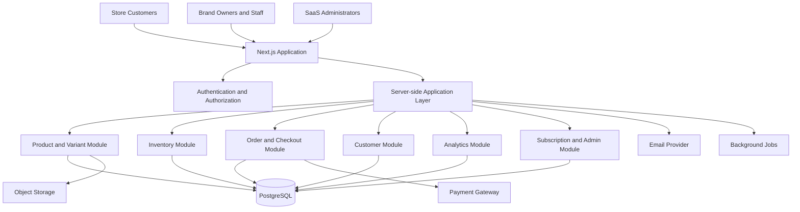

# Technical Requirements Document (TRD)
## Hybrid Clothing Brand SaaS

**Document Version:** 1.0  
**Status:** Proposed Technical Architecture  
**Last Updated:** 14 October 2026  
**Product Type:** Multi-tenant SaaS  
**Target Customers:** D2C clothing brands, boutiques, and social-commerce sellers

---

## 1. Technical Overview

### 1.1 Purpose

This document defines the proposed technical architecture, technology stack, application modules, data requirements, security controls, integrations, deployment strategy, and engineering standards for the Clothing Brand SaaS.

It translates the requirements defined in `PRD.md` into an implementation-oriented technical plan.

### 1.2 Product Architecture

The platform will combine:

- A business management dashboard.
- A public storefront for each clothing brand.
- A shared backend and database.
- Product, variant, and inventory services.
- Centralized order and customer management.
- Payment and subscription management.
- Sales and inventory analytics.
- Platform administration.

The architecture must support multiple independent businesses without exposing one tenant's data to another.

### 1.3 Architecture Principles

1. Security and tenant isolation by design.
2. One authoritative inventory and order system.
3. Server-side validation of business rules.
4. Transactional order creation and stock updates.
5. Modular application architecture.
6. Responsive storefront and dashboard interfaces.
7. Maintainable code and reusable components.
8. Observable, testable, and recoverable production systems.
9. Integration-ready design without unnecessary complexity.
10. No implementation technology is considered final until approved.

---

## 2. Proposed Technology Stack

The following is a proposed stack for review. Technologies and versions must be confirmed before implementation.

### 2.1 Frontend

| Technology | Purpose |
|---|---|
| Next.js | Web application framework |
| React | Component-based user interfaces |
| TypeScript | Static typing |
| Tailwind CSS | Styling and responsive layouts |
| Lucide React | Interface icons |
| React Hook Form | Form state management |
| Zod | Client and server input validation |
| TanStack Table | Data tables, filtering, and sorting where needed |

The frontend will contain both the business dashboard and public storefront experiences.

### 2.2 Backend

| Technology | Purpose |
|---|---|
| Next.js server-side capabilities | Server-rendered pages and application endpoints |
| TypeScript | Shared types and business logic |
| Server-side services | Product, inventory, order, customer, and subscription rules |
| API routes or Route Handlers | HTTP endpoints and webhooks |
| Background jobs | Deferred notifications, reports, and retryable tasks when required |

The initial architecture should favor a modular monolith instead of separate microservices.

### 2.3 Database and Backend Services

**Proposed option: Supabase**

| Technology | Purpose |
|---|---|
| Supabase PostgreSQL | Relational application database |
| Supabase Auth | Authentication and session management |
| Supabase Storage | Product images and approved business assets |
| Row Level Security (RLS) | Database-level tenant access controls |
| PostgreSQL transactions | Consistent order and inventory operations |

Supabase is a proposed choice, not an approved final decision.

Alternative providers should be evaluated only if the project requirements justify changing this selection.

### 2.4 Integrations

| Integration | Purpose |
|---|---|
| Payment gateway | Online payments, payment verification, and refunds |
| Email provider | Account verification, password recovery, and transactional email |
| WhatsApp Business Platform | Future approved messaging integration |
| Instagram platform integrations | Future supported commerce or messaging capabilities |
| Shipping provider | Future shipment booking and tracking |
| Error monitoring | Production exception tracking |
| Analytics service | Optional product usage analytics |

Initial payment provider, email provider, shipping provider, and integration plans remain to be confirmed.

### 2.5 Testing and Quality

| Technology | Purpose |
|---|---|
| Vitest or Jest | Unit and service tests |
| Playwright | Browser-based end-to-end tests |
| React Testing Library | Frontend component tests |
| TypeScript checks | Compile-time validation |
| ESLint | Code quality and consistency |
| Automated CI checks | Repeatable validation before deployment |

Final testing libraries should be selected consistently rather than installing overlapping tools without a clear requirement.

### 2.6 Deployment and Infrastructure

| Component | Proposed approach |
|---|---|
| Web hosting | Managed Next.js-compatible hosting |
| Database | Managed PostgreSQL through the selected provider |
| File storage | Managed object storage |
| Source control | Git and GitHub |
| CI/CD | Automated checks and deployment pipeline |
| Environment configuration | Separate development, staging, and production settings |
| Backups | Automated database backups and restoration testing |
| Monitoring | Application errors, service health, and important operational metrics |

Docker is optional. It should be introduced when it provides a clear benefit for local development, reproducibility, or deployment.

---

## 3. High-Level Architecture

The application will initially use a modular monolithic architecture.

### 3.1 Architecture Diagram

### 3.2 Request Flow

1. A user accesses the dashboard or public storefront.
2. The application identifies the relevant user session or public store.
3. The server resolves the business tenant using trusted application context.
4. Authorization and tenant access rules are enforced.
5. Business operations execute through the appropriate application service.
6. Database transactions preserve data consistency.
7. The response is returned to the client.
8. Important actions and errors are logged appropriately.

### 3.3 Architectural Boundaries

- Public storefront access must not expose private business information.
- Business dashboard operations require authenticated and authorized access.
- SaaS administrative access must be separate from ordinary tenant permissions.
- Payment credentials and privileged database credentials must remain server-side.
- External integrations must not bypass inventory or order business rules.

---

## 4. Application Modules

### 4.1 Authentication and Workspace Module

Responsibilities:

- Registration and login.
- Password recovery.
- Session validation.
- Business workspace creation.
- User-to-tenant membership.
- Role and permission checks.
- Subscription status association.

### 4.2 Product Catalog Module

Responsibilities:

- Product creation and editing.
- Categories and collections.
- Product images.
- Variant configuration.
- SKU generation and uniqueness.
- Pricing and cost information.
- Store publication status.

### 4.3 Inventory Module

Responsibilities:

- Variant-level stock tracking.
- Stock movement ledger.
- Stock adjustments.
- Inventory reservation and release.
- Low-stock alerts.
- Restocking eligibility.
- Inventory audit history.

The inventory module must be the authoritative source for stock quantities.

### 4.4 Storefront Module

Responsibilities:

- Public brand pages.
- Product listings and detail pages.
- Variant selection.
- Shopping cart.
- Checkout interface.
- Store branding.
- Basic SEO.
- Customer-facing order confirmation.

Public storefront data must be explicitly limited to published and available information.

### 4.5 Order and Checkout Module

Responsibilities:

- Cart validation.
- Price and discount calculation.
- Checkout validation.
- Order creation.
- Payment status recording.
- Order status transitions.
- Cancellations.
- Refund records.
- Fulfillment tracking.
- Manual social-order creation.

### 4.6 Customer Module

Responsibilities:

- Customer profiles.
- Contact information.
- Delivery addresses.
- Customer search.
- Order history.
- Customer-to-tenant associations.

### 4.7 Analytics Module

Responsibilities:

- Sales totals.
- Order counts.
- Product performance.
- Variant-level sales.
- Inventory reports.
- Sales channel reports.
- CSV exports.
- Estimated gross margin calculations.

Reports must use consistent definitions and exclude or separately identify cancelled, refunded, and unpaid orders as appropriate.

### 4.8 Subscription and SaaS Administration Module

Responsibilities:

- Tenant administration.
- Subscription plans.
- Trial and free-plan states.
- Usage limits.
- Account status.
- Audit logs.
- Data export and account deletion workflows.

---

## 5. Multi-Tenant Architecture

### 5.1 Tenant Model

The application will use a shared application and database with logical tenant separation.

Each business will have a unique tenant identifier.

Tenant-owned entities will reference that tenant through a `tenant_id` or an explicitly documented parent relationship.

### 5.2 Tenant Isolation Requirements

- Every tenant-owned database record must be associated with the correct tenant.
- Queries must be scoped to the authorized tenant.
- User-provided tenant IDs must never be treated as proof of authorization.
- Public storefront routes must resolve the correct tenant through trusted store configuration.
- Database Row Level Security must enforce appropriate access boundaries.
- Administrative bypasses must be restricted to trusted server-side operations.
- Tenant isolation must be tested through negative authorization tests.

### 5.3 User and Tenant Relationship

The system must support:

- One user owning or belonging to a business workspace.
- Multiple users belonging to the same workspace in future releases.
- A defined role for each user within each workspace.
- Separate SaaS administrator privileges.

Even if staff invitations are deferred, the data model should avoid assumptions that every user can belong to only one tenant forever.

### 5.4 Public Store Access

Public storefront access may expose:

- Published product information.
- Public product images.
- Public prices.
- Public categories and collections.
- Store contact and policy information intended for publication.

Public access must not expose:

- Private stock history.
- Internal cost prices.
- Customer records.
- Unpublished products.
- Business settings that are not public.
- Other tenants' data.

---

## 6. Database Requirements

The detailed schema belongs in `DatabaseSchema.md`.

The following entities are expected.

### 6.1 Identity and Tenancy

- `users` or provider-managed identity records.
- `tenants`
- `tenant_memberships`
- `tenant_settings`
- `subscriptions`
- `subscription_plans`

Identity-provider-managed tables should not be duplicated unnecessarily.

### 6.2 Catalog

- `products`
- `product_variants`
- `categories`
- `collections`
- `product_images`

### 6.3 Inventory

- `inventory_items`
- `inventory_movements`
- `inventory_reservations`, if required by the chosen stock lifecycle.

The inventory model must support variant-level tracking and transactional updates.

### 6.4 Orders and Payments

- `orders`
- `order_items`
- `order_status_history`
- `payments`
- `refunds`
- `discounts`
- `order_discounts`

The exact table boundaries will be finalized in the database schema.

### 6.5 Customers and Social Orders

- `customers`
- `customer_addresses`
- Order channel fields or a controlled sales-channel reference.
- Optional customer notes with appropriate access controls.

Instagram and WhatsApp orders should use the same order tables and services as storefront orders.

### 6.6 Auditing and Operations

- `audit_logs`
- `notification_records`, if required.
- `webhook_events` or an equivalent idempotency record.
- Operational job records where background processing is used.

### 6.7 Data Integrity

- Use primary keys and foreign keys.
- Add unique constraints for tenant-scoped SKUs and store identifiers.
- Index frequently filtered and joined columns.
- Use appropriate decimal/numeric types for monetary values.
- Store timestamps consistently in UTC.
- Store currency explicitly with monetary records.
- Preserve order-time product and price snapshots.
- Avoid hard deletion of records that must remain auditable.

---

## 7. Product and Variant Model

### 7.1 Product

A product represents a clothing style or sellable catalog item.

Expected fields include:

- Product ID.
- Tenant ID.
- Product name.
- Description.
- Category.
- Publication status.
- Product images.
- SEO metadata.
- Created and updated timestamps.

### 7.2 Product Variant

A variant represents a specific sellable combination.

Examples:

- Classic T-shirt / Black / M.
- Classic T-shirt / Black / L.
- Classic T-shirt / White / M.

Expected fields include:

- Variant ID.
- Tenant ID or an enforceable tenant relationship through the product.
- Product ID.
- SKU.
- Size and color attributes.
- Selling price where variant-specific pricing is supported.
- Optional cost price.
- Active status.

### 7.3 SKU Rules

- SKU uniqueness must be enforced at the database level.
- SKU generation must handle concurrent product creation.
- SKU must not be used as the only internal identifier.
- Archived variants must remain distinguishable from deleted or nonexistent variants.
- A variant must belong to the correct tenant-owned product.

### 7.4 Variant Extensibility

The system should allow future attributes such as:

- Fit.
- Fabric.
- Pattern.
- Material.
- Length.
- Style.
- Custom brand-specific attributes.

The MVP should not require a complicated arbitrary attribute engine unless actual customer needs justify it.

---

## 8. Inventory and Order Consistency

This section defines critical technical rules.

### 8.1 Inventory Ledger

Inventory movements must record:

- Tenant.
- Variant.
- Movement type.
- Quantity change.
- Reason or source.
- Related order where applicable.
- Actor or system source.
- Timestamp.

Stock adjustments must be traceable and must not silently overwrite historical movement records.

### 8.2 Stock Lifecycle

The implementation must define whether stock is:

- Available.
- Reserved for an order.
- Committed to a sale.
- Released after cancellation or reservation expiry.
- Returned but awaiting inspection.
- Restocked and available for sale.

The same order lifecycle must be used for website and manual social orders.

### 8.3 Atomic Operations

Order creation and inventory allocation must use database transactions or an equivalent reliable consistency mechanism.

The system must prevent two simultaneous checkouts from selling the same final unit.

### 8.4 Idempotency

Repeated checkout submissions, payment callbacks, refund callbacks, and retried background jobs must not duplicate business effects.

Where external requests support idempotency keys, the application should use them.

### 8.5 Order Snapshots

Order items must preserve:

- Product name at purchase time.
- Variant description at purchase time.
- SKU at purchase time.
- Quantity.
- Unit price.
- Discount allocation.
- Tax and shipping information where applicable.
- Final line-item amount.

Changes to catalog information must not rewrite historical purchases.

---

## 9. API Design

### 9.1 General Requirements

- Use consistent resource naming.
- Validate all incoming payloads.
- Authenticate and authorize protected operations.
- Enforce tenant isolation.
- Return predictable response and error structures.
- Use appropriate HTTP status codes.
- Apply pagination to large collections.
- Rate-limit sensitive endpoints.
- Avoid exposing database internals or secrets.

### 9.2 Proposed API Areas

| Area | Example operations |
|---|---|
| Authentication | Registration, session handling, password recovery |
| Workspace | Read and update business settings |
| Products | Create, read, update, archive |
| Variants | Create and manage variant attributes |
| Inventory | Read stock, adjust stock, inspect movements |
| Storefront | Resolve public store and published catalog |
| Cart | Validate items and calculate totals |
| Checkout | Validate and submit an order |
| Orders | List, read, update status, cancel |
| Customers | Create, search, and view customer history |
| Discounts | Validate and apply coupon codes |
| Reports | Sales, inventory, and channel analytics |
| Subscriptions | Read plan status and enforce usage limits |
| Webhooks | Receive and verify external provider events |

These are logical API areas, not a commitment to create a separate microservice or endpoint for every operation.

### 9.3 Error Handling

Errors should be actionable without revealing sensitive information.

Examples:

- `400` — Invalid input.
- `401` — Authentication required.
- `403` — Authenticated but unauthorized.
- `404` — Resource not found or not accessible.
- `409` — Conflicting operation, such as unavailable stock.
- `422` — Valid request structure but failed business validation, where applicable.
- `429` — Rate limit exceeded.
- `500` — Unexpected server failure.

The API must use a consistent convention for validation and business-rule errors.

---

## 10. Authentication and Authorization

### 10.1 Authentication

- Use the selected identity provider.
- Store session credentials securely.
- Protect account recovery workflows.
- Verify email addresses when required.
- Apply appropriate session expiration and revocation policies.

### 10.2 Authorization

Every protected operation must validate:

1. The authenticated identity.
2. The user's membership in the relevant tenant.
3. The user's permitted role or capability.
4. The requested resource's ownership.
5. Any relevant subscription or business rule.

### 10.3 Role Model

Proposed roles:

- `platform_admin`
- `owner`
- `manager`
- `staff`

The MVP may initially expose only the roles needed for launch, but the permission model should support future expansion.

### 10.4 Administrative Access

- Platform administration must be separate from tenant ownership.
- Privileged operations must be logged.
- Administrative credentials must not be exposed to client-side code.
- Support access must follow an explicit authorization policy.

---

## 11. Payment Integration

### 11.1 Architecture

The application will use a payment-provider adapter or equivalent abstraction to reduce coupling between business logic and the selected provider.

### 11.2 Requirements

- Create payment requests server-side.
- Validate order totals before initiating payment.
- Verify provider responses and webhooks.
- Store provider transaction references.
- Maintain independent order and payment states.
- Prevent duplicate event processing.
- Record refund requests and outcomes.
- Reconcile payment records with provider data where appropriate.

### 11.3 Security

- Never trust client-side payment success alone.
- Never store raw card details.
- Keep API secrets on the server.
- Verify webhook signatures according to provider documentation.
- Reject malformed, unauthorized, or replayed events where applicable.

### 11.4 Provider Selection

The payment gateway remains undecided.

The final choice must consider:

- Supported merchant locations.
- Currency support.
- Fees.
- Settlement timelines.
- Refund handling.
- Webhook reliability.
- Required business verification.
- Compliance requirements.

COD should be implemented as a payment method with its own status and reconciliation rules, not as a successful online payment.

---

## 12. Instagram and WhatsApp Integration

### 12.1 MVP

The initial release will support manual recording of social-media orders.

Users must be able to:

- Select the order channel.
- Select products and variants.
- Enter customer details.
- Validate inventory.
- Create the order through the standard order service.
- Track fulfillment and payment.

### 12.2 Future Integration

Official platform integrations may later support:

- Approved messaging workflows.
- Supported product catalog capabilities.
- Message templates.
- Permitted customer communication.
- Webhook-based events.

All automated integrations must follow the relevant provider's current policies, permissions, and technical requirements.

The MVP must not depend on unofficial browser automation or unsupported private APIs.

---

## 13. Subscription and Usage Enforcement

### 13.1 Requirements

The platform must support:

- Free plan.
- Premium trial.
- Paid plans.
- Plan status.
- Trial expiration.
- Usage limits.
- Feature entitlements.

### 13.2 Enforcement

- Usage limits must be validated server-side.
- Client-side feature hiding is not sufficient.
- Subscription state must be authoritative.
- Payment failure and cancellation workflows must be defined before paid subscriptions launch.
- Existing business data must not be silently deleted when a subscription expires.

### 13.3 Billing Provider

The SaaS subscription billing provider remains undecided.

The selected provider must support the intended merchant jurisdiction and applicable recurring-billing requirements.

---

## 14. File and Image Storage

### 14.1 Product Images

- Store image files in managed object storage.
- Keep file metadata and ownership references in the database.
- Validate file types and sizes.
- Restrict uploads to authorized tenant users.
- Use generated storage paths rather than trusting arbitrary client paths.
- Optimize images for storefront performance.
- Prevent unauthorized access to private files.

### 14.2 Public and Private Assets

Public product images may be accessible through public URLs after publication.

Private documents, internal reports, and sensitive assets must use access-controlled storage.

### 14.3 Image Processing

Advanced image transformation and AI-generated product photography are not required for the MVP.

---

## 15. Security Requirements

### 15.1 Application Security

- Enforce HTTPS.
- Validate input on the server.
- Apply appropriate output encoding.
- Protect against common web vulnerabilities.
- Use secure session and cookie settings.
- Protect privileged endpoints with authorization and rate limiting.
- Keep secrets out of source control.
- Use separate development and production credentials.

### 15.2 Database Security

- Apply tenant-aware Row Level Security policies where supported.
- Restrict privileged database credentials.
- Use foreign keys and integrity constraints.
- Validate access through negative security tests.
- Review policies for every tenant-owned table.
- Prevent public access to private business data.

### 15.3 Audit Logs

Record important actions such as:

- Inventory adjustments.
- Order cancellations.
- Refund operations.
- Permission changes.
- Subscription changes.
- Administrative access.
- Account deletion requests.

Logs must avoid unnecessary sensitive personal information.

### 15.4 Privacy

- Collect only required customer information.
- Restrict customer data access.
- Provide appropriate data export and deletion workflows.
- Apply relevant retention requirements.
- Avoid exposing personal information in URLs, logs, and error messages.

---

## 16. Performance and Scalability

### 16.1 Initial Targets

These are engineering targets to validate under realistic conditions:

- Common dashboard and catalog API requests: target p95 below 500 ms, excluding external provider latency.
- Checkout: optimize for reliability and consistency before raw throughput.
- Product images: responsive sizes and efficient formats.
- Large product and order tables: server-side pagination.
- Reports: avoid blocking checkout and normal business operations.

### 16.2 Database Optimization

- Add indexes for frequent tenant-scoped queries.
- Index foreign keys and commonly filtered columns where beneficial.
- Use pagination and selective field retrieval.
- Avoid unnecessary N+1 database queries.
- Measure query performance before introducing caching.
- Use database transactions for consistency-critical operations.

### 16.3 Caching

Public catalog pages may use appropriate caching.

Private dashboards, inventory, cart totals, and checkout must not use stale cached values as the authority for business decisions.

Inventory availability and final prices must be revalidated at checkout.

### 16.4 Future Scaling

Potential future improvements:

- Background job queues.
- Read-optimized analytics.
- Carefully scoped caching.
- Separate services only when justified by workload or organizational needs.

Microservices are not required for the initial release.

---

## 17. Testing Strategy

### 17.1 Unit Tests

Test:

- Price calculations.
- Discount validation.
- Inventory allocation.
- Order status transitions.
- Payment state transitions.
- Subscription limits.
- Tenant authorization rules.

### 17.2 Integration Tests

Test:

- Database transactions.
- Product and variant persistence.
- Inventory and order interactions.
- Payment webhook processing.
- Authentication and RLS.
- Customer and channel attribution.
- Data exports.

### 17.3 End-to-End Tests

Test complete workflows:

1. Business signup and onboarding.
2. Product creation with multiple variants.
3. Storefront publication.
4. Customer checkout.
5. Order fulfillment.
6. Cancellation and eligible restocking.
7. Manual Instagram/WhatsApp order entry.
8. Reporting.
9. Subscription limit enforcement.
10. Unauthorized cross-tenant access attempts.

### 17.4 Critical Test Cases

- Two customers attempt to buy the final unit simultaneously.
- The same payment webhook is received twice.
- A checkout is retried after a network timeout.
- An order is cancelled more than once.
- A returned item is restocked more than once.
- A user changes a tenant identifier in an API request.
- A published product is archived while present in a cart.
- A subscription expires during normal business operations.

---

## 18. Deployment and Environments

### 18.1 Environments

Maintain separate environments for:

- Local development.
- Staging/testing.
- Production.

Credentials and production customer data must not be casually reused in development.

### 18.2 CI/CD

The deployment pipeline should include:

1. Dependency installation.
2. Formatting and linting checks.
3. Type checking.
4. Unit and integration tests.
5. Production build validation.
6. Approved database migration process.
7. Deployment to the appropriate environment.
8. Health verification and error monitoring.

### 18.3 Database Migrations

- Version-control schema changes.
- Review migrations before production deployment.
- Prefer backward-compatible changes when possible.
- Back up data before risky migrations.
- Test migrations in staging.
- Document rollback or recovery procedures.

### 18.4 Docker

Docker is optional for MVP.

Use it only if the selected hosting architecture or team workflow benefits from consistent containerized development or deployment.

---

## 19. Monitoring, Backup and Recovery

### 19.1 Monitoring

Monitor:

- Application exceptions.
- Checkout and payment errors.
- Failed webhook processing.
- Database failures.
- Authentication anomalies.
- Inventory consistency incidents.
- Background job failures where applicable.

### 19.2 Backup

- Configure automated backups through the selected database provider.
- Define backup retention.
- Restrict access to backups.
- Document restoration procedures.
- Perform periodic restoration tests.

### 19.3 Recovery Objectives

Before production launch, define:

- Recovery Point Objective (RPO): acceptable amount of data loss.
- Recovery Time Objective (RTO): acceptable service restoration time.

Targets should reflect the chosen hosting plan, backup capability, business risk, and budget.

---

## 20. Technical Risks

| Risk | Mitigation |
|---|---|
| Cross-tenant data exposure | RLS, server authorization, and negative tests |
| Inventory overselling | Atomic updates, reservations, and concurrency tests |
| Payment duplication | Idempotent webhook processing |
| Inconsistent order state | Explicit state machine and transactions |
| Unreliable social integrations | Manual workflow first; approved integrations later |
| Uncontrolled infrastructure cost | Managed services and usage monitoring |
| Database migration failures | Versioned migrations and staging tests |
| Slow storefront | Responsive images, query optimization, and performance testing |
| Inaccurate reports | Documented metrics and consistent accounting rules |
| Excessive architecture complexity | Modular monolith and evidence-based scaling |

---

## 21. Proposed Development Order

### Phase 0: Architecture

- Confirm technology decisions.
- Define repository structure.
- Design database entities and relationships.
- Define tenant isolation and permissions.
- Define inventory and order state transitions.

### Phase 1: Foundation

- Configure application framework.
- Implement authentication.
- Implement tenant workspaces.
- Configure database access policies.
- Create base UI and settings.

### Phase 2: Catalog and Inventory

- Products and categories.
- Apparel variants and SKUs.
- Stock records and movement ledger.
- Low-stock alerts.
- Inventory consistency tests.

### Phase 3: Commerce

- Public storefront.
- Product pages and cart.
- Checkout.
- Order creation.
- Payment records and optional gateway.
- Customer order history.

### Phase 4: Operations

- Order management.
- Manual social-order entry.
- Cancellation and return handling.
- Basic discounts.
- Sales and inventory reporting.

### Phase 5: Launch Readiness

- Subscription enforcement.
- Administrative console.
- Security testing.
- Backup and restoration.
- Monitoring and deployment.
- Pilot and production validation.

### Phase 6: Enhancements

- Supplier management.
- CSV import.
- Custom domains.
- Courier integrations.
- Advanced analytics.
- Approved social integrations.

Detailed tasks and milestones will be maintained in `Development_Roadmap.md`.

---

## 22. Decisions Still Requiring Approval

The following items must not be treated as finalized until explicitly approved:

- Frontend and backend framework.
- Database and backend service provider.
- Hosting and deployment provider.
- Payment gateway.
- SaaS subscription billing provider.
- Email provider.
- Social-media integration scope.
- Supported currency and initial market.
- Store URL and custom-domain strategy.
- Free-plan and paid-plan limits.
- Backup and recovery targets.
- Any proposed change to the agreed technology stack.

The architecture should remain adaptable without prematurely implementing every possible integration.

---

## 23. Related Documentation

- `PRD.md` — Product requirements and business goals.
- `MVP_Feature_Scope.md` — Required, optional, and future features.
- `UI_UX_Brief.md` — Visual and interaction design.
- `AppFlow.md` — User journeys and workflow behavior.
- `DatabaseSchema.md` — Detailed schema and relationships.
- `Development_Roadmap.md` — Tasks, phases, and milestones.
- `README.md` — Project overview and setup instructions.

Changes to core business rules must be reflected consistently across these documents.

---

## 24. Final Technical Direction

The proposed initial architecture is a modular monolithic web application with:

- A shared dashboard and storefront codebase.
- A server-side application layer.
- A relational database.
- Secure tenant isolation.
- A variant-aware inventory engine.
- Transactional order management.
- Provider-based payment integration.
- Centralized analytics and administration.

The objective is to build a secure, reliable, maintainable foundation that supports the finalized MVP without introducing unnecessary distributed-system complexity.

All proposed technology choices remain subject to explicit approval before the stack is changed or implementation begins.
