# YOUPI PG V2 — Payment Gateway Security & Architecture Evaluation

**Project**: VÉLURE ATELIER (Luxury E-Commerce SaaS)  
**Evaluator**: Senior Payment Integration & Security Architect  
**Target Repository**: `https://github.com/youpi-pg/YouPI-PG.git`  
**Evaluation Date**: October 2026  
**Status**: ⚠️ **EXPERIMENTAL RESEARCH SOFTWARE — STRICTLY UNSUITABLE FOR PRODUCTION**

---

## 1. Executive Summary & Production Suitability Decision

Following a forensic audit of the `YouPI-PG` repository source code, architecture, security model, and regulatory standing:

> [!CAUTION]
> **PRODUCTION SUITABILITY DECISION: REJECTED FOR PRODUCTION USE**  
> YOUPI PG V2 is an experimental, non-certified research project. It relies on uncertified reverse-engineered scraping of personal banking alerts (SMS parsing, Gmail scraping, and headless browser sessions) rather than official NPCI/banking aggregator rails. Deploying this system with real customer funds or production bank accounts violates banking terms of service, lacks NPCI certification, poses severe data privacy and regulatory compliance risks under RBI guidelines, and offers zero dispute or chargeback settlement mechanisms.
>
> **Action**: Live payment processing is **STRICTLY DISABLED**. VÉLURE ATELIER implements a clean, provider-agnostic payment abstraction with an isolated development adapter and simulated testing environment. Production deployments require a certified aggregator (e.g., Razorpay, Cashfree, or Stripe).

---

## 2. Integration Architecture

YOUPI PG V2 functions as a self-hosted orchestrator that pairs dynamic vector SVG UPI QR codes with external banking observers:

```mermaid
flowchart TD
    subgraph VelureStorefront["Vélure Atelier Storefront (Next.js)"]
        Customer[Customer Checkout]
        PaymentService[Payment Provider Abstraction]
        WebhookReceiver[Secure Webhook Handler]
    end

    subgraph YouPiGateway["YOUPI PG Gateway (Self-Hosted Node.js / SQLite)"]
        PaymentAPI["Payment Core API (:6100)"]
        CheckoutPortal["Checkout Portal (:7000)"]
        QueueEngine["Single-Slot FIFO Queue"]
        AttributionEngine["Attribution & Regex Parser"]
        WebhookEngine["HMAC Webhook Dispatcher"]
    end

    subgraph ExternalObservers["Uncertified Banking Observers (High Risk)"]
        AndroidApp["Android SMS Reader APK"]
        GmailScraper["Gmail OAuth / Web CDP Scraper"]
        GoogleMessages["Google Messages Headless Browser"]
    end

    Customer -->|1. Initiate Checkout| PaymentService
    PaymentService -->|2. POST /api/v1/payments| PaymentAPI
    PaymentAPI -->|3. Return checkoutUrl| PaymentService
    Customer -->|4. Redirect or Modal| CheckoutPortal
    CheckoutPortal -->|5. Single Payer Lock| QueueEngine
    Customer -->|6. Scan Dynamic UPI QR| MerchantAccount[(Merchant Bank Account)]
    
    MerchantAccount -.->|Push SMS Alert| AndroidApp
    MerchantAccount -.->|Push Credit Email| GmailScraper
    AndroidApp -->|Forward Alert Text| AttributionEngine
    GmailScraper -->|Forward Parsed Text| AttributionEngine
    
    AttributionEngine -->|Attributed Match| WebhookEngine
    WebhookEngine -->|7. POST HMAC-SHA256 Signed Webhook| WebhookReceiver
```



### Critical Architectural Bottleneck: Single-Slot FIFO Queue
Because standard Indian personal/retail UPI accounts do not issue dynamic virtual account numbers (VANs), the gateway cannot distinguish between two customers simultaneously paying the exact same amount (e.g., ₹3,850). To work around this limitation, YOUPI PG enforces an **exclusive single-slot FIFO queue**: only one customer in the world can view a QR code and make a payment at any given moment for a receiving account, forcing other buyers into a waiting queue. This architecture fails under basic e-commerce concurrency.

---

## 3. Confirmed API Endpoints & Payloads

### A. Payment Session Creation
- **Endpoint**: `POST /api/v1/payments`
- **Headers**:
  - `Content-Type: application/json`
  - `X-Merchant-Id`: UUID string (e.g., `00000000-0000-0000-0000-000000000001`)
  - `Idempotency-Key`: UUID string (optional but recommended)
  - `X-Merchant-Key`: Merchant webhook secret string (required for private session binding)
- **Request Payload**:
  ```json
  {
    "orderId": "VEL-2024-8842",
    "amount": "3850.00",
    "currency": "INR",
    "returnUrl": "https://atelier.velure.in/checkout/callback",
    "customer": {
      "name": "Priya Sundaram",
      "email": "priya@example.com",
      "phoneNumber": "9820144521"
    },
    "metadata": {
      "internalOrderId": "ord_1729520000_abc"
    }
  }
  ```
- **Response Payload (HTTP 201 Created / 200 Replay)**:
  ```json
  {
    "paymentId": "c7942127-14e3-469a-9e4a-9359a16f903a",
    "orderId": "VEL-2024-8842",
    "amount": "3850.00",
    "amountPaise": "385000",
    "currency": "INR",
    "status": "INITIATED",
    "queuePosition": 0,
    "checkoutUrl": "http://localhost:7000/checkout/c7942127-14e3-469a-9e4a-9359a16f903a"
  }
  ```

### B. Payment Status Verification
- **Endpoint**: `GET /api/v1/payments/:id`
- **Headers**: `X-Merchant-Key: <webhookSecret>` (omitting this returns an unauthenticated, redacted view)
- **Response Payload (HTTP 200 OK)**:
  ```json
  {
    "paymentId": "c7942127-14e3-469a-9e4a-9359a16f903a",
    "orderId": "VEL-2024-8842",
    "amount": "3850.00",
    "amountPaise": "385000",
    "currency": "INR",
    "status": "SUCCESS",
    "method": "UPI",
    "completedAt": "2026-10-21T14:30:00.000Z",
    "internalStatus": "SUCCESS",
    "verificationLevel": 2,
    "verificationTag": "DUAL_SMS_GMAIL_VERIFIED",
    "metadata": { "internalOrderId": "ord_1729520000_abc" }
  }
  ```

### C. Server-to-Server Webhook
- **Method**: `POST` to merchant's configured endpoint
- **Headers**:
  - `Content-Type: application/json`
  - `X-Gateway-Event`: `SUCCESS` | `FAILED` | `EXPIRED` | `CANCELLED`
  - `X-Gateway-Signature`: `sha256=<64_hex_character_hmac>`
  - `X-Gateway-Delivery-Id`: UUID string
  - `X-Gateway-Timestamp`: Unix millisecond timestamp string
- **Webhook Payload**:
  ```json
  {
    "event": "SUCCESS",
    "paymentId": "c7942127-14e3-469a-9e4a-9359a16f903a",
    "orderId": "VEL-2024-8842",
    "attemptId": "c7942127-14e3-469a-9e4a-9359a16f903a",
    "amount": "3850.00",
    "amountPaise": 385000,
    "currency": "INR",
    "method": "UPI",
    "utr": "429482104921",
    "verificationTag": "DUAL_VERIFIED",
    "verificationLevel": 2,
    "completedAt": "2026-10-21T14:30:00.000Z",
    "metadata": { "internalOrderId": "ord_1729520000_abc" }
  }
  ```

---

## 4. Security Findings & Vulnerabilities

| ID | Category | Severity | Description |
| :--- | :--- | :--- | :--- |
| **SEC-01** | Regulatory / Compliance | **CRITICAL** | **Unlicensed Payment Aggregator Model**: Operates outside NPCI guidelines and RBI Payment Aggregator frameworks. Banks actively freeze accounts exhibiting commercial scraping patterns. |
| **SEC-02** | Credential Scraping | **HIGH** | **Mailbox & SMS Infiltration**: Requires giving the server access to personal Gmail accounts (via full mail-read scopes) or running an unverified APK on an Android device with notification/SMS read permissions. |
| **SEC-03** | Concurrency Denial | **HIGH** | **Single-Slot Bottleneck**: By design, only 1 customer can pay at any given moment. A burst of 10 concurrent buyers will stall checkout with queue wait times exceeding 5 minutes per user. |
| **SEC-04** | Attribution Spoofing | **MEDIUM** | **Regex False Positives**: Payment verification is based on regular expressions parsing SMS/email text. An SMS with similar wording, refund credits, or transfers from friends could be falsely attributed. |
| **SEC-05** | Network Exposure | **MEDIUM** | **Multi-Port Surface Area**: Exposes 7 separate TCP ports (6100, 7000, 6001, 8090, 6003, 6002, 3000) with ad-hoc token authentication stored in plaintext files (`data/.secrets/*`). |
| **SEC-06** | Zero Refund Rails | **HIGH** | **No Programmatic Refunds**: The core engine has no refund API. Any return, cancellation, or double-payment must be manually resolved by human banking portal operations. |

---

## 5. Payment Verification Limitations

YOUPI PG **does not connect to banking APIs**. Its verification pipeline relies entirely on:
1. `bank-sms-parser.js`: Regular expressions scanning SMS strings for keywords like `credited`, `received`, `UPI/`, followed by extracting monetary figures.
2. `bank-email-parser.js`: Parsing HTML/plain-text alert emails delivered to a Gmail inbox.
3. Fingerprinting: SHA-256 hash of `amountPaise + bankReferenceNumber + observedDate`.

**Risks**:
- Delayed cellular SMS delivery (frequent with Indian telecom carriers) causes legitimate payments to time out as `FAILED` or `EXPIRED`.
- When an observation arrives 10 minutes late, the session is already terminated, creating customer reconciliation nightmares (`LATE_UNMATCHED`).
- Bank SMS format changes immediately break regex matchers, silently dropping all payment confirmations.

---

## 6. Test Capabilities & Simulation Modes

The repository provides a development test mechanism:
- In test environments (`NODE_ENV=development` with `YOUPI_ALLOW_DEV_TOOLS=true`), simulated observations can be posted via `/api/v1/admin/dev/simulate-observation`.
- Pre-checkout OTP verification can be bypassed using `YOUPI_EXPOSE_DEV_OTP=true`.
- Auto-activation flag: `autoActivate: true` on `POST /api/v1/payments` allows immediate slot activation without interactive WhatsApp verification.

---

## 7. Licensing & Legal Constraints

- **`package.json` License**: Marked as `"Commercial"` with `"private": true`.
- **Repository Disclaimer**: Explicitly states it is an *"independent, experimental research and learning project"* and *"not represented as a certified, bank-approved, NPCI-approved, audited, or production-ready payment gateway."*
- **Legal Risk**: Using uncertified software to process commercial customer transactions in India violates RBI payment guidelines and merchant acquirer terms.

---

## 8. Architectural Action Plan for Vélure Atelier

To satisfy the task requirements while enforcing absolute financial and operational safety:

1. **Provider Abstraction (`src/services/payment/`)**:
   - Create a clean `PaymentProvider` interface supporting `createSession()`, `verifyWebhook()`, `getPaymentStatus()`, and `handleWebhookEvent()`.
2. **Isolated YOUPI Development Adapter**:
   - Implement `YoupiPaymentProvider` conforming strictly to the verified REST and HMAC-SHA256 contract.
   - Enforce a strict `isProductionSafe(): false` invariant: prevent live activation in production.
3. **Mock Simulation Mode for Safe Testing**:
   - Include a deterministic test adapter (`MockPaymentProvider`) to execute end-to-end tests without spawning external observer daemons or touching bank accounts.
4. **Authoritative Webhook Endpoint (`/api/webhooks/payment`)**:
   - Raw-body HMAC-SHA256 signature validation with `crypto.timingSafeEqual`.
   - Idempotent processing and atomic status updates on internal orders.
5. **Fail-Safe Storefront Checkout UI**:
   - Support graceful redirect / hosted session initiation.
   - Inform the patron clearly that the payment session is in development sandbox mode.
